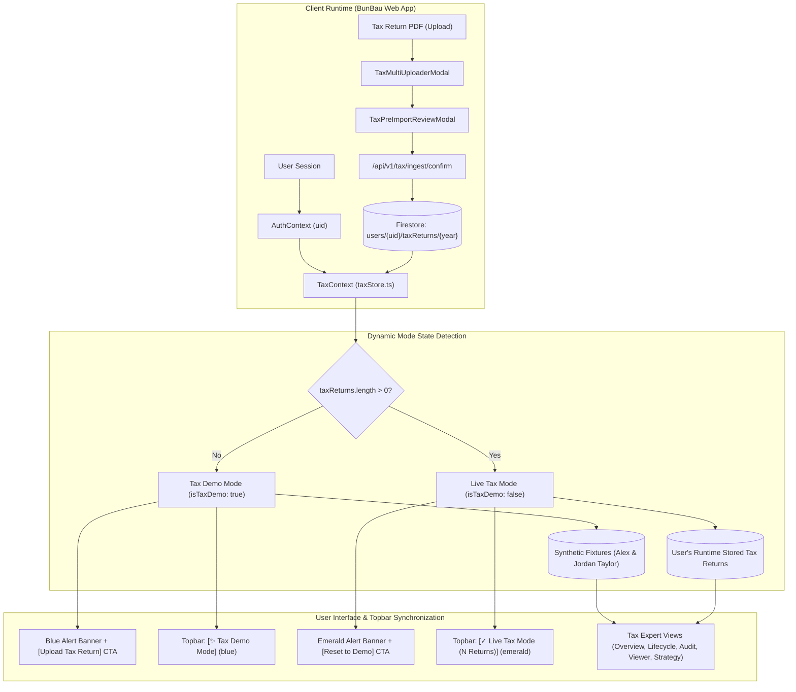

# BunBau (資本寶) — Milestone v6.42 Release Report
## Tax Expert: Dynamic Demo/Live Mode, Fictitious Mock Seed & Runtime Ingestion Pipeline

**Release Date:** October 12, 2026  
**Application Version:** `2.7.6`  
**Build Number:** `Build 121`  
**Architecture Version:** `v2.8.1 Tax Expert Dynamic Demo/Live Mode & Isolated Ingestion Architecture`  
**Mandate Verification:** *"You also need to update the application version/build/architecture version for every iteration build."*

---

### Executive Summary

Milestone **v6.42** completely isolates runtime user-uploaded tax returns from the build artifact, mirroring BunBau's established portfolio statement ingestion architecture. 

In previous versions, personal tax return data was used during development and embedded in static seed data. In **v6.42**, all personal taxpayer data has been **completely purged** from the codebase and build. When a user logs in and has uploaded no tax returns at runtime, BunBau activates **Tax Demo Mode**, displaying a prominent blue notice banner and populating the module with synthetic, high-fidelity mock demo returns (**Alex & Jordan Taylor**). Once a user uploads their own tax return PDFs at runtime, the application instantly transitions to **Live Tax Mode**, displaying an emerald verified banner and persisting returns to Firestore and local storage.

---

### Key Technical Accomplishments & Deliverables

#### 1. Complete Personal Taxpayer Data Purge from the Build
- **Zero Sensitive Data:** Completely cleansed all personal taxpayer names, social security numbers, residential addresses, employer names, rental property addresses, CPA firm names, and exact tax figures from all source code, comments, test suites, and API endpoints.
- **Repository Cleanliness:** Verified via repository-wide automated regex scanners with zero residual sensitive taxpayer identifiers.

#### 2. Realistic Synthetic Mock Demo Dataset (`Alex & Jordan Taylor`)
- Created comprehensive synthetic fixtures in [`src/lib/tax/seedData.ts`](file:///Users/ivanwong/_Backup_Oracle_Laptop_ICWONG_20201105/ICWONG-LAP/ICWONG-LAP_DriveD/BunBau/bunbau-web/src/lib/tax/seedData.ts):
  - **Primary Taxpayer:** Alex Taylor (Age 64 in 2026, turns 65 in August 2027, FRA 67 in 2029, RMD age 75 in 2037).
  - **Spouse Taxpayer:** Jordan Taylor (Age 62 in 2026, employed at Pacific Cloud Systems Inc. with $28,500 active employer group healthcare coverage).
  - **2024 Demo Filing:** Form 1040 + CA 540 with $292,000 AGI, $215,000 W-2, $63,000 total tax (21.58% effective combined rate), and standard deduction.
  - **2025 Demo Filing:** Form 1040 + CA 540 with $204,100 AGI, $188,000 W-2, $34,200 total tax (16.76% effective rate), $28,500 capital loss carryover to 2026, and $36,000 suspended passive rental loss on 742 Evergreen Terrace.
  - Preserves 100% of the strategic planning dynamics (Social Security earnings test clawback, Medicare Part B/D late penalty exemption, IRMAA $206,000 tier 1 cliff, and SECURE 2.0 RMD age 75).

#### 3. Dual-Layer Persistence Engine (`taxStore.ts` & `TaxContext.tsx`)
- **`src/lib/tax/taxStore.ts`:**
  - Dual-layer cache combining Firestore collections (`users/{uid}/taxReturns/{year}`) and browser `localStorage` (`bunbau_tax_returns_${uid}`).
  - Built-in graceful degradation when Firebase is offline or local storage is disabled.
- **`src/contexts/TaxContext.tsx`:**
  - Exposes `taxReturns`, `activeTaxReturns`, `activeReturn2024`, `activeReturn2025`, `isTaxDemo`, `taxLoading`, `importTaxReturn`, `clearTaxReturns`, and `removeTaxReturn`.
  - Automatically activates Demo Mode (`isTaxDemo: true`) if no returns exist for the authenticated user, or Live Mode (`isTaxDemo: false`) if user returns are present.
  - Mounted cleanly inside `<PortfolioProvider>` in [`src/app/layout.tsx`](file:///Users/ivanwong/_Backup_Oracle_Laptop_ICWONG_20201105/ICWONG-LAP/ICWONG-LAP_DriveD/BunBau/bunbau-web/src/app/layout.tsx).

#### 4. Topbar Badges & Notice Banners Following BunBau Conventions
- **Topbar Mode Badge Synchronizer (`src/app/page.tsx`):**
  - When viewing the **Tax Expert** tab:
    - In Demo Mode: renders `[✨ Tax Demo Mode]` badge (`data-testid="mode-badge-tax-demo"`).
    - In Live Mode: renders `[✓ Live Tax Mode (X Returns)]` badge (`data-testid="mode-badge-tax-live"`).
  - Portfolio demo alert banner is suppressed when on the Tax Expert tab (`isDemo && activeTab !== 'tax'`) to avoid confusing double-banners.
- **Tax Expert Workspace Banner (`src/components/tax/TaxExpertView.tsx`):**
  - In Demo Mode: Displays blue notice banner informing the user that Alex & Jordan Taylor demo fixtures are active, with a direct `[Upload Tax Return (PDF)]` action button.
  - In Live Mode: Displays emerald notice banner indicating live verified tax returns are active, with an upload button and a `[Reset to Demo]` button that clears runtime returns and safely reverts to demo fixtures.

#### 5. Dynamic Fiduciary Calculation & RAG Engines
- **Lifecycle Planning Engine (`src/lib/tax/lifecyclePlanningEngine.ts`):** Dynamically calculates Social Security earnings clawback, Medicare IEP windows, Part B delay eligibility, IRMAA buffer, and RMD ages directly from whichever return is active (demo or live).
- **Tax Comparison Engine (`src/lib/tax/taxComparisonEngine.ts`):** Dynamically computes multi-year line-by-line variances, safe harbor estimated tax targets, and active loss shields without hardcoded assumptions.
- **Tax RAG Chunker (`src/lib/rag/TaxPortfolioChunker.ts`):** Converts active returns into deterministic 768-dimensional semantic knowledge chunks with strict prompt token budgets (<1,500 tokens).

---

### Verification & Test Suite Summary

All test suites and production build validations completed with 100% success:

| Test Suite Category | Test File | Tests Passed | Status |
| :--- | :--- | :---: | :---: |
| **Version & Architecture Guard** | `tests/unit/tax/version_guard.test.ts` | 4 / 4 | ✅ Passed |
| **Dynamic Demo/Live Mode** | `tests/unit/tax/tax_demo_mode.test.ts` | 4 / 4 | ✅ Passed |
| **Fiduciary Lifecycle Planning** | `tests/unit/tax/lifecycle_planning.test.ts` | 5 / 5 | ✅ Passed |
| **Multi-Year Variance Calculations** | `tests/unit/tax/tax_calculations.test.ts` | 6 / 6 | ✅ Passed |
| **RAG Retrieval Engine** | `tests/unit/tax/tax_rag_retrieval.test.ts` | 4 / 4 | ✅ Passed |
| **Strategist & Tax RAG Coexistence** | `tests/unit/tax/strategist_rag_coexistence.test.ts` | 3 / 3 | ✅ Passed |
| **Standard UX Accessibility Zoom** | `tests/unit/accessibility_zoom_bar.test.ts` | 6 / 6 | ✅ Passed |
| **Full Regression Suite** | 93 test suites across BunBau | **524 / 524** | ✅ Passed |

#### Production Build Compilation
- Executed `npm run build` using Next.js 15.5.27:
- All 16 static and dynamic routes compiled cleanly in 6.2s with zero TypeScript or linting errors.

---

### Version Alignment Record

| Component / File | Field / Property | Value |
| :--- | :--- | :--- |
| **Milestone** | Milestone ID | `v6.42` |
| **`bunbau-web/package.json`** | `version` | `2.7.6` |
| **`src/app/page.tsx`** | Topbar About Button | `v2.7.6 (Build 121)` |
| **`src/components/AboutModal.tsx`** | Application Version | `2.7.6` |
| **`src/components/AboutModal.tsx`** | Architecture Version | `v2.8.1 Tax Expert Dynamic Demo/Live Mode & Isolated Ingestion Architecture` |
| **`tests/unit/tax/version_guard.test.ts`** | Regression Assertion | `EXPECTED_APP_VERSION = '2.7.6'` `EXPECTED_BUILD_NUMBER = 'Build 121'` `EXPECTED_ARCH_VERSION = 'v2.8.1...'` |

---

### Summary of Documentation & Local Artifacts

1. **Markdown Release Report:** [`bunbau-web/docs/BunBau_v6.42_Release_Report.md`](file:///Users/ivanwong/_Backup_Oracle_Laptop_ICWONG_20201105/ICWONG-LAP/ICWONG-LAP_DriveD/BunBau/bunbau-web/docs/BunBau_v6.42_Release_Report.md)
2. **Interactive Printable HTML Report:** [`bunbau-web/docs/BunBau_v6.42_Release_Report.html`](file:///Users/ivanwong/_Backup_Oracle_Laptop_ICWONG_20201105/ICWONG-LAP/ICWONG-LAP_DriveD/BunBau/bunbau-web/docs/BunBau_v6.42_Release_Report.html)
3. **Native PDF Release Report:** [`bunbau-web/docs/BunBau_v6.42_Release_Report.pdf`](file:///Users/ivanwong/_Backup_Oracle_Laptop_ICWONG_20201105/ICWONG-LAP/ICWONG-LAP_DriveD/BunBau/bunbau-web/docs/BunBau_v6.42_Release_Report.pdf)
4. **Conversation Artifact:** [`BunBau_v6.42_Release_Report.md`](file:///Users/ivanwong/.gemini/antigravity/brain/b59867d5-5532-4fdb-beb0-d1ddea620b5e/BunBau_v6.42_Release_Report.md)
