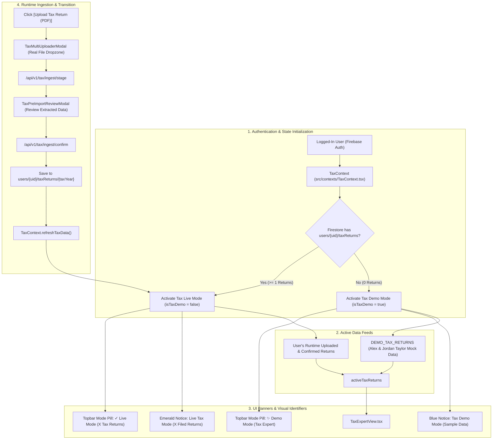

# BunBau (資本寶) — Milestone v6.42 Implementation Plan
## Tax Expert: Dynamic Demo/Live Mode, Fictitious Mock Seed & Runtime Ingestion Pipeline

**Document Status:** Ready for Approval  
**Target Milestone:** `v6.42`  
**Target Application Version:** `2.7.6 (Build 121)`  
**Target Architecture Version:** `v2.8.1 Tax Expert Dynamic Demo/Live Mode & Isolated Ingestion Architecture`  
**Core Purpose:** Decouple run-time uploaded personal tax data from the build, create synthetic mock demo returns for Demo Mode, purge all private taxpayer information from repository source code, and implement dynamic Demo vs. Live mode detection and banners following BunBau's established portfolio design pattern.

---

### Executive Summary

In BunBau, brokerage account intelligence adheres to a clean separation of concerns:
- **Demo Mode:** When a user logs in and has uploaded no brokerage statements (`accounts.length === 0`), the application activates Demo Mode, displays a prominent blue alert banner, and populates the UI with synthetic seed accounts.
- **Live Mode:** Once the user uploads a verified statement, the application dynamically transitions to Live Mode, shows the green verified badge, and saves accounts under `users/{uid}/accounts` in Firestore.

Currently, the Tax Expert module (v2.8 / Build 120) relied on actual filed returns (Harmony Quan & Ivan Wong) embedded as default fixtures in `seedData.ts`. 

Milestone **v6.42** completely resolves this:
1. **Purges all personal tax data from the build:** Completely replaces actual personal information (Harmony Quan, Ivan Wong, Viapath Technologies, 906 Sacramento St, 3343 Los Prados, Justin Arney CPA) with high-fidelity, sanitized **synthetic mock demo returns** (Alex & Jordan Taylor).
2. **Establishes `TaxContext`:** Introduces a first-class React context (`src/contexts/TaxContext.tsx`) that detects whether real tax return PDFs have been uploaded at runtime by the authenticated user.
3. **Dynamic Mode Banners:** Renders a prominent **Tax Demo Mode banner** (when 0 returns are uploaded) and a **Live Tax Mode banner** (when 1+ verified returns are uploaded), matching BunBau's existing portfolio design language.
4. **Runtime Ingestion Pipeline:** Enables users to upload their real Form 1040/540 PDFs at runtime, preview extracted liabilities in `TaxPreImportReviewModal`, and commit them securely into Firestore (`users/{uid}/taxReturns/{year}`) with a 1-click option to reset back to Demo Mode.

---

### Architecture & System Flow



---

### Detailed Implementation Specifications

#### 1. Synthetic Mock Demo Dataset (`src/lib/tax/seedData.ts`)
Purges all real personal data from source code and replaces it with synthetic mock returns:
- **Taxpayer Profiles:**
  - Primary: **Alex Taylor** (Age 64, DOB: 1962-08-15, Medicare at 65 in 2027)
  - Spouse: **Jordan Taylor** (Age 62, DOB: 1964-03-20, Social Security window opens in 2026)
  - Fictitious Address: `100 Pine Street #1500, San Francisco, CA 94111`
  - Fictitious CPA: `Pacific Bay Tax Advisors, San Francisco, CA`
  - Fictitious Employer: `Pacific Cloud Systems Inc.` (Box 12 Code DD group health plan: $28,500)
  - Fictitious Rental Property: `742 Evergreen Terrace, San Francisco, CA 94107`
  - Fictitious Partnership: `Taylor Family Equity Partners LP`
- **Mock Return Mathematical Figures:**
  - **2024 Return:** W-2 Wages $215,000, Taxable Interest $18,500, Dividends $5,200, AGI $292,000, Standard Deduction $29,200, NIIT $1,596, Total Tax $47,200, Payments $49,500.
  - **2025 Return:** W-2 Wages $188,000, Taxable Interest $16,200, Dividends $6,400, Net Capital Loss -$3,000 (creating **$28,500 capital loss carryover to 2026**), Suspended Rental Loss **$36,000 to 2026** under Form 8582, AGI **$204,100** (safely below the $206,000 IRMAA cliff with $1,900 buffer), Itemized Deductions **$48,500** under the $40,000 SALT cap, Total Tax **$23,400**, Overpayment **$23,800** applied to 2026.
- **Lifecycle Engine Continuity:**
  - Jordan age 62 Social Security earnings test clawback under $188k+ salary (100% clawback -> recommended deferral to age 70 for $4,150/mo).
  - Alex age 65 Medicare coordination with Jordan's active employer health plan.
  - IRMAA Tier 1 monitoring ($204,100 vs $206,000 threshold).
  - SECURE 2.0 RMD age 75 (2037 & 2039) with 10-year Roth conversion tax valley.

#### 2. Runtime Context & State Management (`src/contexts/TaxContext.tsx`)
Mirrors `PortfolioContext` architecture:
```typescript
interface TaxContextType {
  taxReturns: CompleteTaxYearReturn[]; // Runtime-uploaded live returns
  isTaxDemo: boolean;                  // true if taxReturns.length === 0
  activeTaxReturns: CompleteTaxYearReturn[]; // returns live data or mock demo
  taxLoading: boolean;
  refreshTaxData: () => Promise<void>;
  importTaxReturn: (ret: CompleteTaxYearReturn) => Promise<void>;
  clearTaxReturns: () => Promise<void>; // resets back to Demo Mode
  deleteTaxReturn: (taxYear: number) => Promise<void>;
}
```
- Listens to authenticated user state (`useAuth`).
- Fetches returns from Firestore: `users/{uid}/taxReturns/{year}`.
- Supports dual-layer caching via `localStorage` for offline / immediate session access (`bunbau_tax_returns_${uid}`).

#### 3. Dynamic Mode Banners & Visual Identifiers
- **Topbar Indicator (`src/app/page.tsx`):**
  - When active tab is `tax`:
    - If `isTaxDemo`: Renders blue badge `<Sparkles size={12} /> Tax Demo Mode`.
    - If `!isTaxDemo`: Renders emerald badge `<CheckCircle2 size={12} /> Live Tax Mode (${userTaxReturns.length} Returns)`.
- **In-App Alerts (`src/components/tax/TaxExpertView.tsx`):**
  - **Demo Mode Banner:** Informing the user they are viewing sample mock data (Alex & Jordan Taylor) with a prominent `[Upload Tax Return (PDF)]` call-to-action button.
  - **Live Mode Banner:** Confirming verified live filings ({years}), displaying active loss carryovers, with an `[Upload Another Year]` button and a `[Reset to Demo]` option.

#### 4. Runtime Ingestion & PDF Staging Pipeline
- **`TaxMultiUploaderModal.tsx`:**
  - Clears hardcoded file references.
  - Adds real HTML5 drag-and-drop file dropzone and file picker input accepting `.pdf`.
  - Dispatches uploaded file to `/api/v1/tax/ingest/stage`.
- **`TaxPreImportReviewModal.tsx`:**
  - Displays actual extracted data for user approval.
  - Clicking `[Confirm & Import]` commits the return via `/api/v1/tax/ingest/confirm`, saves the file to the document vault, updates `TaxContext`, and instantly flips the application to **Live Tax Mode**.

#### 5. Shared RAG & AI Co-Pilot Adaptation
- Semantic Chunker (`TaxPortfolioChunker`) chunks `activeTaxReturns` dynamically:
  - In Demo Mode: Chunks synthetic demo returns with zero private data.
  - In Live Mode: Chunks the user's verified live tax returns.
- Strictly maintains the token budget ceiling (<1,500 tokens / 6,000 characters).

#### 6. Version Tracking Enforcement
- Mandate: *"You also need to update the application version/build/architecture version for every iteration build."*
- **Application Target Version:** `2.7.6`
- **Build Number:** `Build 121`
- **Architecture Target Version:** `v2.8.1 Tax Expert Dynamic Demo/Live Mode & Isolated Ingestion Architecture`
- Updated in `package.json`, `AboutModal.tsx`, `page.tsx`, and test assertions.

---

### Step-by-Step Execution Plan

| Step | Action Item | Target Files |
| :--- | :--- | :--- |
| **1** | Create `TaxContext` and Provider | `src/contexts/TaxContext.tsx`, `src/app/layout.tsx` (or inside `page.tsx`) |
| **2** | Overhaul `seedData.ts` with Synthetic Mock Demo Data | `src/lib/tax/seedData.ts` |
| **3** | Update Tax Comparison & Lifecycle Engines for Dynamic Input | `src/lib/tax/taxComparisonEngine.ts`, `src/lib/tax/lifecyclePlanningEngine.ts` |
| **4** | Implement Mode Banners & Dynamic Topbar Mode Pills | `src/app/page.tsx`, `src/components/tax/TaxExpertView.tsx` |
| **5** | Build Clean File Uploader & Staging Endpoints | `src/components/tax/TaxMultiUploaderModal.tsx`, `src/components/tax/TaxPreImportReviewModal.tsx`, `src/app/api/v1/tax/ingest/stage/route.ts`, `src/app/api/v1/tax/ingest/confirm/route.ts` |
| **6** | Connect Shared RAG Spine to Dynamic Active Returns | `src/lib/rag/TaxPortfolioChunker.ts`, `src/lib/rag/HybridRetriever.ts` |
| **7** | Version Alignment to 2.7.6 (Build 121) | `package.json`, `AboutModal.tsx`, `page.tsx`, `tests/unit/tax/version_guard.test.ts` |
| **8** | Automated Test Verification | `tests/unit/tax/tax_demo_mode.test.ts`, `tests/unit/tax/tax_calculations.test.ts`, `npm test`, `npm run build` |

---

### Local File Links & PDF Print Access

- **Local Markdown Plan:** [BunBau_v6.42_Tax_Demo_Live_Mode_Implementation_Plan.md](file:///Users/ivanwong/_Backup_Oracle_Laptop_ICWONG_20201105/ICWONG-LAP/ICWONG-LAP_DriveD/BunBau/bunbau-web/docs/BunBau_v6.42_Tax_Demo_Live_Mode_Implementation_Plan.md)
- **Local PDF File:** [BunBau_v6.42_Tax_Demo_Live_Mode_Implementation_Plan.pdf](file:///Users/ivanwong/_Backup_Oracle_Laptop_ICWONG_20201105/ICWONG-LAP/ICWONG-LAP_DriveD/BunBau/bunbau-web/docs/BunBau_v6.42_Tax_Demo_Live_Mode_Implementation_Plan.pdf)
- **Local Printable HTML Document:** [BunBau_v6.42_Tax_Demo_Live_Mode_Implementation_Plan.html](file:///Users/ivanwong/_Backup_Oracle_Laptop_ICWONG_20201105/ICWONG-LAP/ICWONG-LAP_DriveD/BunBau/bunbau-web/docs/BunBau_v6.42_Tax_Demo_Live_Mode_Implementation_Plan.html)
- **Artifact Plan:** [BunBau_v6.42_Tax_Demo_Live_Mode_Implementation_Plan.md](file:///Users/ivanwong/.gemini/antigravity/brain/b59867d5-5532-4fdb-beb0-d1ddea620b5e/BunBau_v6.42_Tax_Demo_Live_Mode_Implementation_Plan.md)
