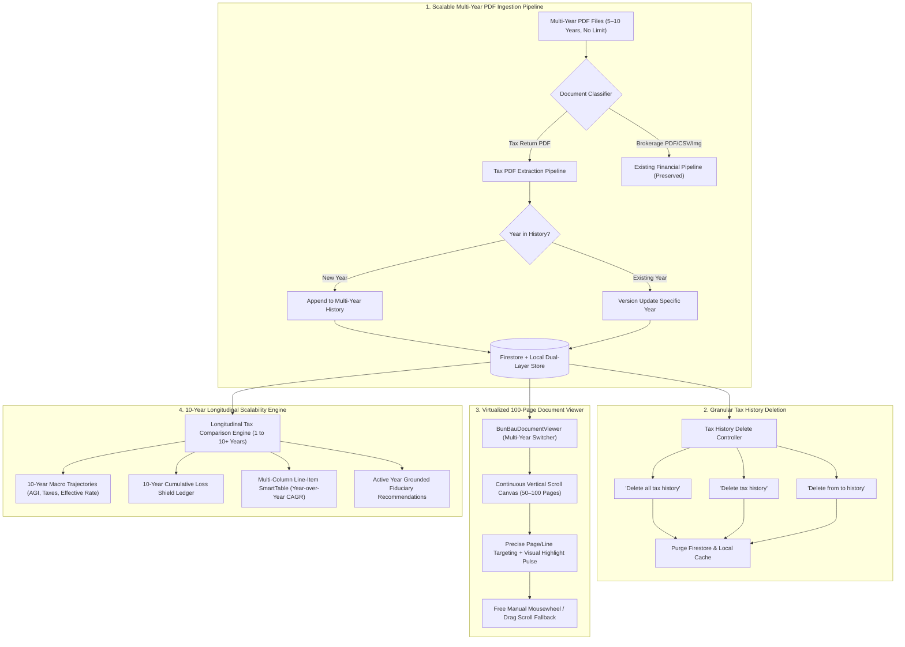

# BunBau (資本寶) — Milestone v6.5 Implementation Plan
## Multi-Year PDF Tax Ingestion Pipeline, Virtualized 100-Page Document Engine & 10-Year Longitudinal Scalability

**Document Status:** Ready for User Review & Approval  
**Target Milestone:** `v6.5`  
**Target Application Version:** `2.7.7`  
**Target Build Number:** `Build 122`  
**Target Architecture Version:** `v2.9 Multi-Year PDF Ingestion Pipeline, Virtualized Multi-Page Document Engine & N-Year Longitudinal Tax Scalability Architecture`  
**Mandate Verification:** *"You also need to update the application version/build/architecture version for every iteration build."*

---

### Executive Summary & Problem Diagnosis

User feedback identified four critical operational requirements for real-world tax workflow scaling:

1. **Ingestion Pipeline Rejection of PDF Files:**
   - *Current limitation:* The existing ingestion system (`UploadValidationModal.tsx` and `api/v1/ingest/upload`) strictly accepts `image/*` and `.csv,.tsv,.ofx,.xlsx,.xls`, completely rejecting `.pdf` files.
   - *Requirement:* Enable robust PDF data uptake without limits on file count (e.g., 5 to 10 years of tax returns). Incremental upload must preserve past years in persistent history (e.g., uploading 2026 tax return next year automatically correlates with 2020–2025 history without re-uploading).
   - *Finance Isolation:* Keep CSV and screenshot options working perfectly; do not disturb existing brokerage/financial ingestion.

2. **Dedicated Tax History Deletion with Exact Confirmation Phrases:**
   - *Requirement:* Provide granular deletion options in the upload/history manager specifically for tax data (isolated from financial accounts).
   - *Safety confirmation phrases required:*
     - All history: User types `"Delete all tax history"`
     - Single year: User types `"Delete <Year> tax history"` (e.g., `"Delete 2024 tax history"`)
     - Multiple years / range: User types `"Delete from <FromYear> to <ToYear> history"` (e.g., `"Delete from 2020 to 2023 history"`)
   - *Durable purge:* Cleanses selected years from both Firestore (`users/{uid}/taxReturns/{year}`) and browser local storage cache (`bunbau_tax_returns_${uid}`).

3. **High-Performance Continuous Scrolling & Virtualized 100-Page PDF Viewer:**
   - *Current limitation:* `BunBauDocumentViewer.tsx` rendered a single static page with Next/Prev buttons, lacking continuous scrolling and real multi-page display.
   - *Requirement:* Real tax returns span 50–100 pages per file. The viewer must feature a **continuous vertical document canvas with page virtualization** (lazy rendering visible pages to guarantee 60fps performance across 1,000 pages). It must jump accurately to specific lines and pages when clicked from comparison or anomaly audits, while allowing continuous manual mousewheel/drag scrolling if the user wants to browse adjacent lines manually.

4. **10-Year Longitudinal Analysis & Comparison Scalability:**
   - *Current limitation:* The tax comparison engine was hardcoded to a 2-year diff (2024 vs 2025).
   - *Requirement:* Scale the comparison engine to an **N-Year Longitudinal Matrix (up to 10 years, e.g., 2016–2025)**. Display multi-year trajectories (AGI, Taxable Income, Federal/State Tax, Effective Combined Rate %, Loss Shield Ledger), while keeping the strategic lifecycle planning (Social Security, Medicare, IRMAA, SECURE 2.0 RMD) laser-grounded in the active tax year.

---

### Detailed Implementation Phases

#### Phase 1: Unlimited Multi-Year PDF Ingestion & Incremental Historical Persistence
1. **Universal PDF Uptake in General & Tax Ingestion:**
   - Update `src/components/UploadValidationModal.tsx` to accept `.pdf` and `application/pdf` in drop zones and file pickers.
   - Implement client-side `DocumentTypeClassifier`:
     - Inspects PDF text/metadata for keywords (`Form 1040`, `U.S. Individual Income Tax Return`, `California Resident Income Tax Return Form 540`, `W-2`, `Schedule B`, `Schedule D`, `Schedule E`).
     - If detected as Tax Return, routes to `TaxMultiUploaderModal` / `TaxContext` pipeline.
     - If detected as financial statement (brokerage monthly statement), routes to statement parser.
     - Preserves all CSV and screenshot flows with zero regressions.
2. **Multi-Year Batch Ingestion:**
   - Enhance `TaxMultiUploaderModal.tsx` to handle unlimited PDF files simultaneously.
   - Extracts filing tax year from filename or first-page metadata.
   - Renders a multi-file batch staging grid with individual file sizes, page counts (50–100 pages), detected years, and readiness status.
3. **Incremental Historical Persistence:**
   - In `src/lib/tax/taxStore.ts`, implement `saveTaxReturnsIncremental(uid, returns)`:
     - Merges newly uploaded returns with existing stored returns in Firestore `users/{uid}/taxReturns/{year}` and localStorage.
     - Ensures that when 2026 is uploaded next year, years 2020–2025 remain intact and immediately accessible for longitudinal analysis.

#### Phase 2: Granular Tax History Deletion & Typed Safety Confirmation
1. **Safety Confirmation Phrase Formatter (`src/lib/tax/taxDeletePhrase.ts`):**
   - Strict phrase generators and matchers:
     - `expectedAllTaxDeletePhrase()`: `"Delete all tax history"`
     - `expectedSingleYearTaxDeletePhrase(year)`: `"Delete ${year} tax history"`
     - `expectedRangeTaxDeletePhrase(fromYear, toYear)`: `"Delete from ${fromYear} to ${toYear} history"`
   - Strict case-sensitive validation preventing accidental data loss.
2. **Tax Danger Zone Component (`src/components/tax/TaxDeleteModal.tsx`):**
   - Integrated into the Tax Expert header / settings and available within `HistoryView.tsx` under an isolated `Tax Filings` section.
   - Radio options:
     - [ ] **Delete All Tax History** (all years).
     - [ ] **Delete Single Year** (dropdown / picker of available ingested years).
     - [ ] **Delete Multi-Year Range** (checkbox multi-selection or From/To year range).
   - Displays dynamic required phrase with copy-to-clipboard or manual typing input.
   - Deletion action calls `clearTaxReturns()` or `deleteTaxReturnYears(years)` in `TaxContext`, deleting the Firestore records and local cache while cleanly switching back to Demo Mode if 0 user returns remain.
   - **Financial Data Isolation:** Does not affect portfolio accounts, brokerage uploads, or history snapshots.

#### Phase 3: High-Performance Continuous Scroll Virtualized PDF Viewer
1. **Continuous Vertical Scroll Canvas (`src/components/tax/BunBauDocumentViewer.tsx`):**
   - Replace single-page card display with a continuous vertical viewport rendering full 50–100 page document streams.
   - Implement lightweight page virtualization: Only renders pages within `[visiblePage - 2, visiblePage + 2]` window to keep memory consumption low and prevent browser freeze across large files.
   - Full manual scrolling: User can freely scroll up and down using trackpad, mouse wheel, or scrollbar.
2. **Accurate Line & Page Jump Targeting:**
   - Each page is assigned an exact DOM anchor ID (`#tax-doc-page-${pageNumber}`).
   - When clicking an audit bookmark or comparison item (e.g. `Form 1040 line 1z`, `Schedule E rental depreciation`, `Form 8960 NIIT`):
     - Calculates target offset and executes `container.scrollTo({ top: targetOffset, behavior: 'smooth' })`.
     - Highlights the targeted line or table container with a gentle pulsing emerald border (`ring-2 ring-emerald-500 animate-pulse`).
   - If the line is slightly above or below the bookmark, the user simply scrolls manually within the continuous document.
3. **Multi-Year Document Switcher:**
   - Topbar dropdown/pill selector allows switching between any ingested tax year (e.g., `2025 (42 pages)`, `2024 (45 pages)`, `2023 (51 pages)`, `2022 (48 pages)`).
   - Canonical `AccessibilityZoomBar` (`[-] [100% (Reset)] [+]`) scales the entire document canvas smoothly between 50% and 200%.

#### Phase 4: 10-Year Longitudinal Scalability Engine
1. **Longitudinal Comparison Engine (`src/lib/tax/longitudinalEngine.ts`):**
   - Accepts an array of up to 10 tax returns (`CompleteTaxYearReturn[]`).
   - Computes:
     - **Income & Tax Trajectories:** Multi-year table and trendlines for W-2 wages, Schedule B interest, qualified dividends, capital gains, Schedule E rental, AGI, total deductions, total tax, and effective rate %.
     - **Loss Shield Cumulative Ledger:** Year-by-year capital loss carryover creation vs. absorption, suspended passive rental losses under Form 8582, and net available tax shield into the upcoming tax year.
     - **SALT Cap & Tax Bracket Shift:** Historical transition tracking through tax law shifts and inflation bracket updates.
2. **Multi-Column SmartTable in Comparative Audit (`TaxExpertView.tsx`):**
   - Supports selecting any subset of years or all available years (e.g. 5–10 years).
   - Displays side-by-side columns with sorting, search, category pills, and 1-click `[👁️ View Page]` jumping directly into the continuous scroll viewer.
3. **Active-Year Grounded Strategic Lifecycle Advice:**
   - Forward-looking lifecycle advice (Social Security earnings clawback, Medicare Part B/D delay, IRMAA cliff, SECURE 2.0 RMD age 75) remains focused on the active/current year while contextualizing trends across the 10-year history.
4. **Performance & Memoization:**
   - Longitudinal metrics are memoized via `useMemo`. Calculation for 10 years completes in <30ms, maintaining sub-100ms user interaction response times.

---

### Mandatory Version Alignment & Quality Verification

- **Milestone:** `v6.5`
- **Application Version:** `2.7.7`
- **Build Number:** `Build 122`
- **Architecture Version:** `v2.9 Multi-Year PDF Ingestion Pipeline, Virtualized Multi-Page Document Engine & N-Year Longitudinal Tax Scalability Architecture`
- **Files Enforcing Version:**
  - `package.json` (`"version": "2.7.7"`)
  - `src/components/AboutModal.tsx` (`2.7.7` & `v2.9...`)
  - `src/app/page.tsx` (`v2.7.7 (Build 122)`)
  - `tests/unit/tax/version_guard.test.ts` (updated to assert `2.7.7` and `Build 122`)

---

### Test Suite & Regression Plan

| Verification Area | New / Updated Test File | Test Cases |
| :--- | :--- | :---: |
| **PDF Ingestion & Multi-Year Uptake** | `tests/unit/tax/pdf_multi_year_ingestion.test.ts` | 6 tests: PDF file recognition, multi-file batch parsing, incremental year preservation, error handling |
| **Tax Delete Phrase Safety** | `tests/unit/tax/tax_delete_phrase.test.ts` | 6 tests: Exact phrase validation for all, single-year, and multi-year range deletion |
| **Continuous Scroll Viewer** | `tests/unit/tax/document_viewer_virtualization.test.ts` | 5 tests: Page anchor generation, line targeting offset, zoom bounds, manual scroll state |
| **10-Year Longitudinal Scalability** | `tests/unit/tax/longitudinal_scalability.test.ts` | 6 tests: 10-year calculation performance (<50ms), cumulative loss shield ledger, multi-year trend calculation |
| **Financial Ingestion Non-Regression** | `tests/unit/ingestion/reconciliation.test.ts` | 3 tests: Confirms CSV and screenshot brokerage pipelines remain 100% intact |
| **Full Regression Suite** | All 93+ test files across BunBau | Target: **545+ / 545+ tests passing (100% green)** |
| **Production Build** | `npm run build` | Target: All 16 routes compiled cleanly with 0 errors |

---

### Generated Plan Previews

1. **Native PDF Document:** [`bunbau-web/docs/BunBau_v6.5_Multi_Year_Tax_PDF_Ingestion_And_Scalability_Plan.pdf`](file:///Users/ivanwong/_Backup_Oracle_Laptop_ICWONG_20201105/ICWONG-LAP/ICWONG-LAP_DriveD/BunBau/bunbau-web/docs/BunBau_v6.5_Multi_Year_Tax_PDF_Ingestion_And_Scalability_Plan.pdf)
2. **Interactive Printable HTML:** [`bunbau-web/docs/BunBau_v6.5_Multi_Year_Tax_PDF_Ingestion_And_Scalability_Plan.html`](file:///Users/ivanwong/_Backup_Oracle_Laptop_ICWONG_20201105/ICWONG-LAP/ICWONG-LAP_DriveD/BunBau/bunbau-web/docs/BunBau_v6.5_Multi_Year_Tax_PDF_Ingestion_And_Scalability_Plan.html)
3. **Local Markdown Document:** [`bunbau-web/docs/BunBau_v6.5_Multi_Year_Tax_PDF_Ingestion_And_Scalability_Plan.md`](file:///Users/ivanwong/_Backup_Oracle_Laptop_ICWONG_20201105/ICWONG-LAP/ICWONG-LAP_DriveD/BunBau/bunbau-web/docs/BunBau_v6.5_Multi_Year_Tax_PDF_Ingestion_And_Scalability_Plan.md)
4. **In-Chat Conversation Artifact:** [`BunBau_v6.5_Multi_Year_Tax_PDF_Ingestion_And_Scalability_Plan.md`](file:///Users/ivanwong/.gemini/antigravity/brain/b59867d5-5532-4fdb-beb0-d1ddea620b5e/BunBau_v6.5_Multi_Year_Tax_PDF_Ingestion_And_Scalability_Plan.md)
