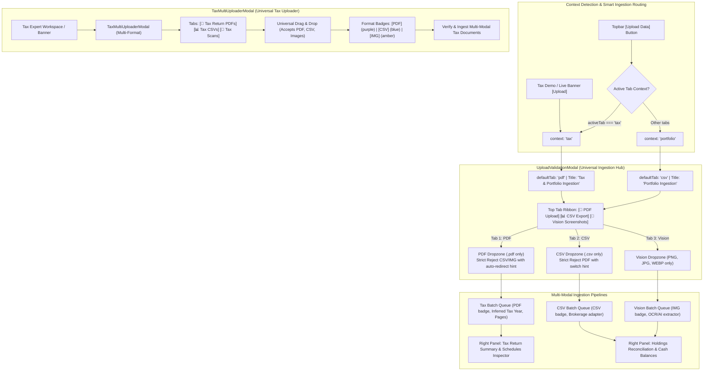

# BunBau (資本寶) — Milestone v6.6 Implementation Plan
## Universal Multi-Modal Ingestion Panel (PDF, CSV & Vision) & Context-Aware Tax Expert Ingestion Architecture

**Document Version:** `v1.0`  
**Target Milestone:** `v6.6`  
**Application Version:** `2.7.8`  
**Build Number:** `Build 123`  
**Architecture Version:** `v2.9.1 Universal Multi-Modal Tax & Portfolio Ingestion Architecture (PDF, CSV, Vision)`  
**Mandate Verification:** *"You also need to update the application version/build/architecture version for every iteration build."*

---

### 1. Problem Statement & Root Cause Analysis

Based on user review and visual analysis of the current UI (Screenshots 1 & 2):

```
┌───────────────────────────────────────────────────────────────────────────────────────────────────────┐
│ SCREENSHOT 1 DEFECT: Ingestion Panel Mismatch for Tax Expert                                          │
│ 1. Header is hardcoded to "Portfolio Ingestion" even when triggered from or for Tax Expert.          │
│ 2. Top ribbon only has 2 tabs: [Brokerage CSV Export] [Screenshots (Vision)]. No PDF tab exists.      │
│ 3. Dropping tax return PDFs into the CSV tab mislabels them as "CSV" with "Parsed Holdings (0)".     │
│ 4. No strict per-tab file type enforcement (allows PDFs into CSV queue, creating confusion).          │
├───────────────────────────────────────────────────────────────────────────────────────────────────────┤
│ SCREENSHOT 2 DEFECT: Tax Uploader Modal Only Accepts PDFs                                             │
│ 1. "Upload Tax Returns (IRS Form 1040 & Form 540)" strictly rejects any non-PDF file.                │
│ 2. Users with 1099 CSVs, Schedule D trading CSVs, or scanned W-2/1040 screenshot images cannot       │
│    ingest them into Tax Expert.                                                                       │
│ 3. Lacks universal multi-modal tabs and multi-format batch queuing.                                   │
└───────────────────────────────────────────────────────────────────────────────────────────────────────┘
```

---

### 2. Architecture & Design Blueprint



---

### 3. Implementation Plan — Step-by-Step

#### Step 1: Mandatory Version Tracking & Version Guard Update
- Update `package.json` -> `"2.7.8"`
- Update `src/components/AboutModal.tsx` -> `2.7.8` & `Build 123` & `v2.9.1 Universal Multi-Modal Tax & Portfolio Ingestion Architecture (PDF, CSV, Vision)`
- Update `src/app/page.tsx` line 294 -> `v2.7.8 (Build 123)`
- Update `tests/unit/tax/version_guard.test.ts` and `tests/unit/accessibility_zoom_bar.test.ts` to enforce `2.7.8` and `Build 123`.

#### Step 2: Context-Aware Smart Branching & PDF Tab in `UploadValidationModal.tsx`
- **Props Enhancement:**
  ```ts
  interface UploadValidationModalProps {
    isOpen: boolean;
    onClose: () => void;
    onApprove: (extraction: ExtractionResult, files: File[]) => Promise<void> | void;
    onDeleteData?: (mode: DeleteScope, institution?: string) => Promise<void>;
    institutions?: string[];
    existingAccounts?: CanonicalAccount[];
    context?: 'portfolio' | 'tax';
    initialTab?: 'pdf' | 'csv' | 'vision';
  }
  ```
- **3 Symmetrical Autonomous Tabs:**
  - `[📄 PDF Upload (Tax Returns)]` (`data-testid="tab-pdf"`)
  - `[📊 Brokerage CSV Export]` (`data-testid="tab-csv"`)
  - `[📸 Screenshots (Vision)]` (`data-testid="tab-vision"`)
- **Smart Context Default:**
  - If `context === 'tax'` or opened from Tax Expert, `activeTab` initializes to `'pdf'`, and modal title renders **"Tax & Portfolio Ingestion"**.
  - If `context === 'portfolio'`, `activeTab` initializes to `'csv'`, and title renders **"Portfolio Ingestion"**.
- **Strict Per-Tab File Type Enforcement:**
  - **In `tab-csv`:** Rejects `.pdf` files. Shows alert: *"Tax return PDF detected! Switch to the 'PDF Upload' tab to ingest Form 1040/540 returns."*
  - **In `tab-pdf`:** Rejects non-PDF files unless explicitly switched to CSV or Vision tabs.
  - **In `tab-vision`:** Rejects non-image files.
- **PDF Staging & Inspector Panel:**
  - When in `'pdf'` tab, staged files show **`PDF`** badge (purple/mint), file name, size, and inferred Tax Year (`2025`, `2024`, etc.).
  - Right-hand inspector renders **Tax Return Summary** (Tax Year, Inferred Status, Detected Schedules, Total Pages, Confidence) instead of "Parsed Holdings (0 positions)".
  - Confirmation button: **"Verify & Ingest Tax Filings"** which calls `importTaxReturnsBatch` from `TaxContext`.

#### Step 3: Universal Ingestion in `TaxMultiUploaderModal.tsx`
- Upgrade `TaxMultiUploaderModal` to accept all three formats:
  - **PDFs:** Form 1040, Form 540, Schedules A/B/D/E/8582/8995.
  - **CSVs:** 1099 CSVs, Schedule D capital gains exports, rental income logs.
  - **Screenshots / Images:** Scanned W-2s, 1040 page 1 scans, mobile tax slips (`PNG`, `JPG`, `WEBP`).
- Add Tab Switcher ribbon at top:
  - `[📄 Tax Return PDFs]`
  - `[📊 Tax CSV Exports]`
  - `[📸 Tax Scans & Screenshots]`
- Dynamic format badge per file:
  - `[PDF]` badge in purple
  - `[CSV]` badge in blue
  - `[IMG]` badge in amber
- Display format count summary: e.g., *"4 PDFs, 1 CSV, 1 Scan Staged"*.
- Correlate multi-format assets into the complete tax return objects during verification.

#### Step 4: Topbar Integration in `src/app/page.tsx`
- When user clicks topbar "Upload Data" button while `activeTab === 'tax'`:
  - Pass `context="tax"` and `initialTab="pdf"` to `UploadValidationModal`.
- When on other tabs, pass `context="portfolio"`.

#### Step 5: Comprehensive Regression Testing & Production Build
- Create `tests/unit/tax/universal_upload_modal.test.ts`:
  - Test context-aware default tab selection (`context='tax'` -> `'pdf'`).
  - Test strict per-tab file type rejection (PDF in CSV tab rejected with guidance; non-PDF in PDF tab rejected).
  - Test multi-modal format badges in `TaxMultiUploaderModal` (PDF, CSV, IMG).
- Verify standard UX guard (`no raw <th>` compliance).
- Run full test suite (`npm test`) -> 100% green.
- Run production build (`npm run build`) -> 16/16 routes compiled with zero errors.

---

### 4. Verification Checklist & User Sign-off

- [ ] App version updated to `2.7.8`, Build `123`, Architecture `v2.9.1 Universal Multi-Modal Tax & Portfolio Ingestion Architecture (PDF, CSV, Vision)`.
- [ ] `UploadValidationModal` features 3 distinct tabs: `[PDF Upload] [Brokerage CSV Export] [Screenshots (Vision)]`.
- [ ] Strict per-tab file type enforcement (no PDFs mislabeled as CSVs).
- [ ] Context-aware opening: defaults to `PDF Upload` when opened from Tax Expert.
- [ ] `TaxMultiUploaderModal` upgraded to universal multi-modal ingestion (accepts PDF, CSV, and screenshots).
- [ ] Staged queues display proper badges (`PDF`, `CSV`, `IMG`) and inferred tax years.
- [ ] 100% test suite pass across all 98+ test files.
- [ ] Production build succeeds with 0 errors.
