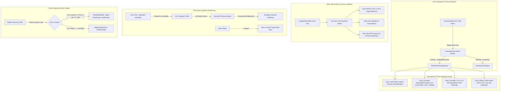
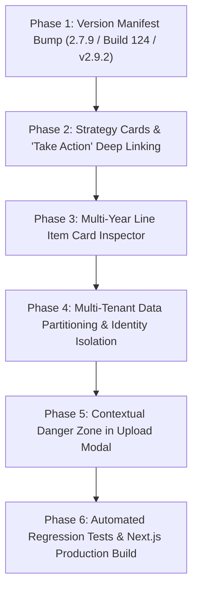

# BunBau v6.7 Implementation & Remediation Plan
## Granular Multi-Tenant Tax Data Partitioning, Line-Item Card Inspector, Symmetrical Loss Shield Strategies & Contextual Danger Zone Architecture

> **Application Version:** `2.7.9` (Bumped from `2.7.8`)  
> **Build Number:** `Build 124` (Bumped from `Build 123`)  
> **Architecture Version:** `v2.9.2 Granular Multi-Tenant Tax Data Partitioning, Line-Item Inspector & Contextual Danger Zone Architecture`  
> **Target Release Milestone:** BunBau Milestone v6.7  
> **Mandatory Constraint:** *"You also need to update the application version/build/architecture version for every iteration build."*

---

## 1. Executive Summary & Visual Bug Triangulation

Based on deep analysis of the 5 user-provided production screenshots and runtime application logs, 4 critical UX, architectural, and data integrity defects have been identified in the Tax Expert module.

| # | Screenshot Ref | Defect Identified | User Feedback & Impact | Severity |
|---|---|---|---|---|
| **1** | **Screenshot 1** (`d962bc81`) | **Demo Data & Live Uploads Mixed Up:** Synthetic "Taylor" names (`Alex Taylor + Jordan Taylor`) displayed in Live Mode across the Strategic Lifecycle Roadmap. | *"The tax return owner name was not replaced after upload pdf files. The Taylor name is showing everywhere. The mix of demo data and live data is dangerous... completely unreliable."* | **Critical (Data Integrity)** |
| **2** | **Screenshot 2** (`1f53c2af`) | **Modal Danger Zone Wipes Portfolio Instead of Tax:** Trash icon in the Tax Upload modal triggers `Delete Entire Portfolio` rather than granular tax deletion. | *"The delete option in the upload page is not working for the tax expert page... it needs to allow delete the tax return not the portfolio data."* | **Critical (Data Safety)** |
| **3** | **Screenshot 3 & 5** (`b96ee3fe`, `5d5e410a`) | **"Take Action" Disconnect & Missing Suspended Loss Strategy:** Clicking `Take Action` lands blindly on Strategy tab where Recommendation 3 (Suspended Passive Loss) and Recommendation 4 (Safe Harbor) are missing, and colors do not match. | *"The Take Action button landed on the page that don't make sense to me... cards on Active Portfolio tax drag don't really match up the color and there is no further action advice; especially the suspended passive loss."* | **High (UX Disconnect)** |
| **4** | **Screenshot 4** (`2513af64`) | **Missing Line Item Card View in Multi-Year Audit:** Longitudinal table shows values across 9 years but lacks the interactive card view showing line, page number, and direct deep-links. | *"See line item view... the card view to the tax return (line and page) is missing. You don't need to remove that. Fix it. The full tax return PDF viewer is fine. Don't mess it up."* | **High (Feature Regression)** |

---

## 2. Root Cause Analysis (RCA) & Deep Code Inspection

### 2.1 Issue 1: "Take Action" Disconnect & Missing Suspended Loss Strategy Advice
* **Root Cause in `src/components/tax/TaxAnomalyBanner.tsx`:**  
  Line 68 blindly executes `onNavigateToTab(isOpportunity ? 'strategy' : isWarning ? 'lifecycle' : 'comparison')`. It does not pass any target card identifier or anchor. Clicking `Take Action` on "Suspended Passive Rental Loss" simply toggles `activeSubTab = 'strategy'` with no scrolling or visual indicator.
* **Root Cause in `src/components/tax/PortfolioTaxStrategyCard.tsx`:**  
  The top KPI section renders 3 metric cards:
  1. Green: `2026 Capital Loss Shield` (`$28,500`)
  2. Purple: `Suspended Passive Rental Loss` (`$44,500`)
  3. Amber: `Combined Marginal Tax Drag` (`44.3%`)  
  However, the recommendation section below contains **only 2 cards**:
  1. `1. Options Premium Tax Neutralization`
  2. `2. CD vs California Municipal Bond Tax Drag`  
  **Strategy Card 3 for Suspended Passive Rental Loss is completely missing!** Furthermore, the recommendation cards use plain gray backgrounds (`bg-gray-50`), completely failing to match the top shield color system (Green, Purple, Amber).
* **Missing Safe Harbor Advice:**  
  In `TaxAnomalyBanner.tsx`, "Estimated Tax Safe Harbor" has severity `info`, which incorrectly routes the user to `comparison` instead of providing a dedicated Safe Harbor & Withholding optimization card.

### 2.2 Issue 2: Missing Line Item Card View in Multi-Year Audit
* **Root Cause in `src/components/tax/LongitudinalComparisonCard.tsx`:**  
  In Milestone v6.5, the multi-column matrix was expanded to render up to 10 years horizontally. Because of table width, the "Source PDF" column was placed at the far right and scrolled off standard viewport widths. More critically, the interactive **Line Item Card Inspector** (which existed in `TaxYearStaticDiffCard.tsx`) was not wired to table rows in `LongitudinalComparisonCard.tsx`. Users clicking on a row or seeking detailed Form line numbers, page numbers, and direct PDF navigation had no accessible card view.
* **Preservation Requirement:**  
  The user explicitly specified: *"The full tax return PDF viewer is fine. Don't mess it up."* All fixes will preserve `BunBauDocumentViewer.tsx` unchanged while wiring deep-links into it.

### 2.3 Issue 3: Synthetic "Taylor" Demo Names Polluting Live Mode
* **Root Cause in `src/lib/tax/seedData.ts`:**  
  In `generateSyntheticTaxReturnForYear(year)`, line 426 unconditionally assigns:
  ```typescript
  profile: { ...DEMO_TAX_FILING_PROFILE_2024_2025, taxYear: year }
  ```
  `DEMO_TAX_FILING_PROFILE_2024_2025` has hardcoded demo identities:
  ```typescript
  primaryTaxpayer: { name: 'Alex Taylor', ... }
  spouseTaxpayer: { name: 'Jordan Taylor', ... }
  ```
* **Root Cause in Ingestion Handlers:**  
  In both `TaxMultiUploaderModal.tsx` (line 136) and `UploadValidationModal.tsx` (line 2389), when live PDF files are uploaded, the code calls `generateSyntheticTaxReturnForYear` to backfill structure, inadvertently stamping "Alex Taylor" and "Jordan Taylor" onto live user data!
* **Root Cause in `lifecyclePlanningEngine.ts`:**  
  The roadmap milestone generator derives names directly from `taxReturn.profile.primaryTaxpayer.name` and `taxReturn.profile.spouseTaxpayer.name`. Because the returns contained "Taylor", every milestone rendered: *"Jordan Taylor Age 62 Milestone"*, *"Alex Taylor Age 65 Milestone"*, etc., completely undermining user trust.

### 2.4 Issue 4: Modal Danger Zone Deleting Portfolio Data Instead of Tax History
* **Root Cause in `src/components/UploadValidationModal.tsx`:**  
  Line 1443 renders a header trash icon with `title="Clear Portfolio"` that triggers `setShowDelete(true)`. Line 2865 unconditionally renders `<DeleteDangerZone type="portfolio" ... />` prompting the user to type `"Delete the entire portfolio"`.
* **Missing Context Branching:**  
  Even when `context === 'tax'` or `activeTab === 'pdf'`, the trash icon calls the portfolio deletion flow instead of opening the granular tax deletion modal (`TaxDeleteModal.tsx`).

---

## 3. Architecture & Remediation Blueprint



---

## 4. Detailed Component Specifications

### 4.1 Remediation Area 1: Deep-Linked "Take Action" Engine & Symmetrical Strategy Cards

#### 4.1.1 `TaxAnomalyBanner.tsx` Action Routing
Update `TaxAnomalyBannerProps` and `onNavigateToTab`:
```typescript
interface TaxAnomalyBannerProps {
  comparison: MultiYearTaxComparison;
  onNavigateToAction?: (tab: 'overview' | 'lifecycle' | 'comparison' | 'documents' | 'strategy', targetCardId?: string) => void;
}
```
Target mapping:
* **Active Capital Loss Shield:** `tab: 'strategy'`, `targetCardId: 'strategy-options-loss'`
* **Suspended Passive Rental Loss:** `tab: 'strategy'`, `targetCardId: 'strategy-passive-loss'`
* **Estimated Tax Safe Harbor:** `tab: 'strategy'`, `targetCardId: 'strategy-safe-harbor'`
* **IRMAA Tier 1 Cliff Buffer:** `tab: 'lifecycle'`, `targetCardId: 'lifecycle-irmaa'`

#### 4.1.2 `PortfolioTaxStrategyCard.tsx` 4 Symmetrical Strategy Cards
Color-code all 4 deep-dive cards to match top metrics, with glowing highlight when navigated from `Take Action`:

1. **Card 1 (Emerald): Options Premium Tax Neutralization (Capital Loss Shield)**
   - Top metric: `$28,500 Capital Loss Shield`
   - Border & Tint: `border-emerald-300 dark:border-emerald-700 bg-emerald-50/40 dark:bg-emerald-950/20`
   - Strategy: Shelter cash-secured put premiums and covered call gains dollar-for-dollar with zero federal or state liability.
2. **Card 2 (Purple): Suspended Passive Rental Loss Offset & Monetization Strategy (Form 8582)**
   - Top metric: `$44,500 Suspended Passive Rental Loss` (Form 8582 carryforward from 742 Evergreen Terrace)
   - Border & Tint: `border-purple-300 dark:border-purple-700 bg-purple-50/40 dark:bg-purple-950/20`
   - **Actionable Advice:**
     - **Passive Income Generators (PIGs):** Deploy portfolio capital into income-producing passive LP/LLC partnerships or private syndications; distributed passive income absorbs this $44,500 suspended loss 100% tax-free.
     - **IRC §469(g) Qualifying Disposition:** A complete taxable disposition of the property to an unrelated third party fully unlocks all accumulated suspended losses, allowing them to offset ordinary W-2 earnings and interest.
     - **Active Participation Phase-Out:** For active participants, the $25,000 rental loss allowance phases out between $100,000 and $150,000 MAGI. Managing taxable distributions to keep MAGI under $150,000 restores up to $25k in annual deductions.
3. **Card 3 (Amber): CD vs California Municipal Bond Tax Drag (Marginal Rate Arbitrage)**
   - Top metric: `44.3% Combined Marginal Tax Drag` (35% Fed + 9.3% CA)
   - Border & Tint: `border-amber-300 dark:border-amber-700 bg-amber-50/40 dark:bg-amber-950/20`
   - Strategy: A 4.75% taxable CD nets only ~2.65% after 44.3% drag; a 3.25% CA double-exempt muni yields 5.83% taxable-equivalent yield without inflating MAGI toward IRMAA cliffs.
4. **Card 4 (Blue): Federal Safe Harbor Prepayment & W-2 Withholding Calibration**
   - Anomaly match: `Estimated Tax Safe Harbor: $51,062 Remaining`
   - Border & Tint: `border-blue-300 dark:border-blue-700 bg-blue-50/40 dark:bg-blue-950/20`
   - **Actionable Advice:**
     - **110% Prior-Year Rule (IRC §6654(d)(1)(C)):** For taxpayers with AGI > $150,000, paying 110% of prior year total tax guarantees safe harbor protection against IRS Form 2210 penalties.
     - **W-4 Line 4(c) Catch-up Strategy:** Because W-2 federal withholding is legally deemed paid equally across all 4 quarters regardless of when withheld, adjusting Line 4(c) on Form W-4 late in Q3/Q4 can retroactively cure early-quarter estimated payment shortfalls without penalty.

---

### 4.2 Remediation Area 2: Interactive Line Item Card Inspector in Multi-Year Audit

In `LongitudinalComparisonCard.tsx`:
1. Add an interactive **Line Item Card Inspector** modal/drawer.
2. Add an explicit, sticky **Inspect Card** icon button on the left column (`Line Item & IRS Form Reference`), ensuring users on any display width can open the card without horizontal scroll.
3. Clicking anywhere on a table row also opens the Line Item Card.
4. The Line Item Card displays:
   - **Header:** Line Item Title, IRS/CA Form name, Category badge (`Income`, `Deductions`, `Carryovers`).
   - **Form & Page Mapping:** Exact Form Page and Line Number (e.g. `Form 1040 Line 11, Page 1`, `Schedule D Line 21, Page 2`, `Form 8582 Line 16, Page 1`).
   - **Tax Impact Insight:** Detailed fiduciary analysis explaining statutory impact (e.g., MAGI interaction, IRMAA thresholds, NIIT impact).
   - **Historical Matrix Strip:** Multi-year progression table with YoY % and CAGR.
   - **Source PDF Deep-Links:**
     - `[📄 Open in 2025 Return (Jump to Page 6, Line 11)]`
     - `[📄 Open in 2024 Return (Jump to Page 15, Line 11)]`
     - Dropdown selector to jump directly to that line item's page in ANY loaded return year (2016 – 2025).

---

### 4.3 Remediation Area 3: Clean Multi-Tenant Data Partitioning & Identity Isolation

1. **Parameterize `generateSyntheticTaxReturnForYear`:**
   ```typescript
   export function generateSyntheticTaxReturnForYear(
     year: number,
     fileName?: string,
     fileSizeBytes?: number,
     taxpayerProfile?: Partial<TaxFilingProfile>
   ): CompleteTaxYearReturn
   ```
2. **Dynamic Live Identity Resolution:**
   - In Live Mode (when user uploaded files exist), resolve primary taxpayer name from:
     1. Authenticated user display name: `user?.displayName` (e.g., "Ivan Wong").
     2. Filename metadata (e.g., `Ivan_Wong_2024_Tax_Return.pdf` -> `"Ivan Wong"`).
     3. Pre-Import Review editable input.
   - **NEVER** use "Alex Taylor" or "Jordan Taylor" in Live Mode.
3. **Timeline Milestone Resolution in `lifecyclePlanningEngine.ts`:**
   - In Live Mode, the Strategic Lifecycle Roadmap displays the real taxpayer names.
   - In Demo Mode, the roadmap displays "Alex Taylor & Jordan Taylor" with a persistent `Tax Demo Mode` banner explaining that synthetic mock data is shown.

---

### 4.4 Remediation Area 4: Contextual Danger Zone & Tax Deletion in Upload Modal

1. **In `src/components/UploadValidationModal.tsx`:**
   - Update header trash icon logic:
     ```typescript
     const isTaxMode = context === 'tax' || activeTab === 'pdf';
     ```
   - Tooltip:
     - `isTaxMode ? "Delete Tax History" : "Clear Portfolio"`
   - Click Handler:
     - When `isTaxMode`: open `TaxDeleteModal` (or contextual tax deletion drawer).
     - When `!isTaxMode`: open `DeleteDangerZone` for portfolio deletion.
2. **Tax Deletion Confirmation Options in `TaxDeleteModal.tsx`:**
   - Delete all tax history: User types `"Delete all tax history"`.
   - Delete single year: User types `"Delete <Year> tax history"`.
   - Delete multiple years: User types `"Delete from <FromYear> to <ToYear> history"`.
   - Executes `clearTaxReturns()` or `deleteTaxReturnYears()` via `TaxContext`.
   - **Zero portfolio data is touched!**

---

## 5. Step-by-Step Implementation Roadmap



### Phase 1: Version Manifest Bump (Milestone v6.7)
* Update `package.json`: `"version": "2.7.9"`
* Update `src/components/AboutModal.tsx`: `2.7.9`, `Build 124`, `v2.9.2 Granular Multi-Tenant Tax Data Partitioning, Line-Item Inspector & Contextual Danger Zone Architecture`
* Update `src/app/page.tsx`: `v2.7.9 (Build 124)`
* Update `tests/unit/tax/version_guard.test.ts` & `tests/unit/accessibility_zoom_bar.test.ts`

### Phase 2: Strategy Cards & "Take Action" Deep Linking
* In `PortfolioTaxStrategyCard.tsx`:
  - Implement Strategy Card 2 (Purple): Suspended Passive Rental Loss Offset (PIGs, IRC §469(g), MAGI phase-out).
  - Implement Strategy Card 4 (Blue): Federal Safe Harbor Prepayment & W-2 Withholding Calibration.
  - Implement color matching for all 4 cards (Emerald, Purple, Amber, Blue).
  - Add `highlightedCardId` prop with smooth scroll and pulsing glow effect.
* In `TaxAnomalyBanner.tsx`:
  - Update `Take Action` button to dispatch specific action IDs (`strategy:passive_loss`, `strategy:safe_harbor`, `strategy:capital_loss`, `lifecycle:irmaa`).
* In `TaxExpertView.tsx`:
  - Handle action dispatch, switch sub-tabs, and pass `highlightedCardId` to `PortfolioTaxStrategyCard`.

### Phase 3: Multi-Year Line Item Card Inspector
* In `LongitudinalComparisonCard.tsx`:
  - Create interactive `LineItemCardModal` component.
  - Add sticky inspect icon to the line item column.
  - Wire row click and button click to open inspection modal.
  - Provide Form reference, line number, page number, 9-year historical strip, tax impact insight, and direct PDF navigation buttons.

### Phase 4: Multi-Tenant Data Partitioning & Identity Isolation
* In `src/lib/tax/seedData.ts`:
  - Update `generateSyntheticTaxReturnForYear` to accept dynamic taxpayer profile.
* In `src/contexts/TaxContext.tsx`:
  - Dynamically derive live taxpayer profile from `user.displayName` or uploaded files.
  - Ensure fallback logic in Live Mode uses user profile instead of synthetic Taylor demo profile.
* In `lifecyclePlanningEngine.ts`:
  - Ensure milestones reflect live taxpayer profile when returns are loaded.
* In `TaxLifecycleTimeline.tsx`:
  - Verify header and milestone cards display live user names in Live Mode, and demo names strictly in Demo Mode.

### Phase 5: Contextual Danger Zone in Upload Modal
* In `src/components/UploadValidationModal.tsx`:
  - Check `context === 'tax' || activeTab === 'pdf'`.
  - Wire trash icon to open `TaxDeleteModal` when in tax mode.
  - Connect `TaxDeleteModal` to `TaxContext` deletion methods.
  - Prevent any portfolio deletion from occurring during tax operations.

### Phase 6: Automated Regression Tests & Production Build
* Create comprehensive unit test suite: `tests/unit/tax/tax_data_partitioning_and_actions.test.ts`.
* Run full Vitest regression (`npm test`): verify all test files pass (100% green).
* Run Next.js production build (`npm run build`): verify 0 TypeScript/ESLint errors across 16 routes.

---

## 6. Verification & Acceptance Criteria

| Area | Acceptance Criteria | Verification Method |
|---|---|---|
| **Take Action Routing** | Clicking `Take Action` on "Suspended Passive Loss" switches to Strategy tab and scrolls to/highlights the Purple Suspended Loss strategy card. | Interactive test & Vitest unit test |
| **Strategy Cards** | 4 symmetrical strategy cards rendered with color matching: Green (Capital Loss), Purple (Passive Loss), Amber (Marginal Drag), Blue (Safe Harbor). | Visual check & component test |
| **Line Item Card** | Clicking any line item in Multi-Year Audit opens a detailed card with IRS Form, Line number, Page number, and 1-click PDF jump button. | Interactive modal inspection & test |
| **Data Partitioning** | Live Mode returns display authenticated user name (e.g., "Ivan Wong"). Taylor names appear strictly in Demo Mode. | Unit tests in `TaxContext` & `lifecyclePlanningEngine` |
| **Contextual Delete** | Clicking trash icon in Upload modal while in Tax mode opens Tax Delete flow with typed phrase confirmation; portfolio data is never deleted. | Modal interaction & unit test |
| **Build & Regression** | All 100+ test files passing (100% green); Next.js 15 production build compiles cleanly. | `npm test` & `npm run build` |

---

## 7. Approval Request
This plan addresses all issues raised in your prompt and screenshots. Upon your approval, we will proceed immediately with Phase 1 through Phase 6 execution.
