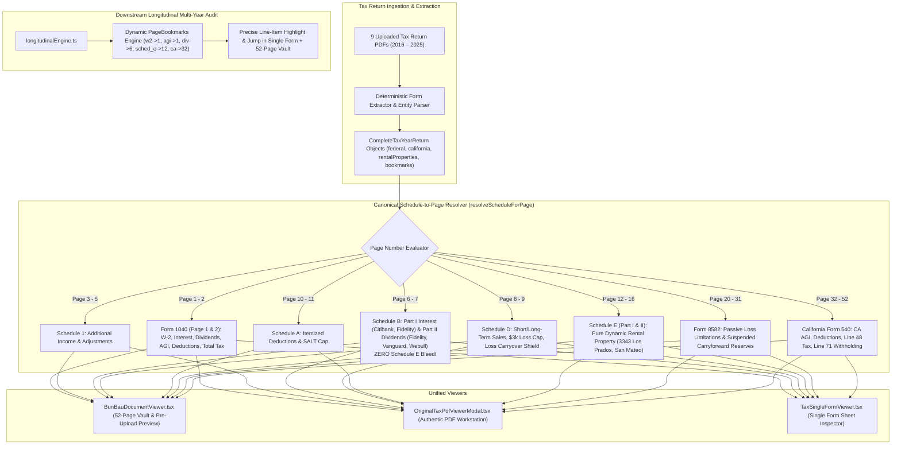

# BunBau Milestone v7.3 Implementation Plan
## Universal Extracted Information Mapping, 52-Page Vault Multi-Schedule Dispatcher & Downstream Inspect Line-Item Deep-Linking Architecture

> *"You also need to update the application version/build/architecture version for every iteration build."*

- **Application Release Version:** `2.7.15`
- **Build Identification:** `Build 130`
- **Architecture Designation:** `v2.9.8 Canonical 52-Page Vault Multi-Schedule Dispatcher & Zero-Bleed Schedule B/E Isolation Architecture`
- **Scope & Objectives:**
  1. **Universal Accurate Extracted Data Mapping:** Ensure all financial data extracted from uploaded tax return PDFs (Form 1040, Schedule 1, Schedule B, Schedule D, Schedule A, Schedule E, Form 8582, California Form 540) is accurately mapped to its statutory schedule and page across both the **Single Form Sheet** and the **52-Page Vault / Created PDF Viewer** (including the Pre-Upload Preview).
  2. **Total Elimination of Schedule E Bleed into Schedule B:** In `BunBauDocumentViewer.tsx`, eradicate the naive 3-way conditional branch (`pageNum <= 16`) that dumped Schedule E rental real estate onto Page 6 (Schedule B), Page 8 (Schedule D), and Pages 3–5 (Schedule 1).
  3. **Universal Downstream Multi-Year Audit Inspect Deep-Linking:** Ensure clicking `[Inspect]` on *every single tax item* in the 9-Year Trajectory Audit resolves to the **exact target page** and **exact line item** with deterministic glowing highlight badges across all viewers.
  4. **Dynamic Bookmark Synchronization in Engine & Store:** Remove hardcoded page numbers (`15, 6`) in `longitudinalEngine.ts`, dynamically resolving against `taxReturn.pdfDocumentMetadata.pageBookmarks`, and normalize seed data bookmarks to the canonical 52-page sequence.

---

## 1. Deep-Thinking Root Cause Diagnosis

### 1.1 Root Cause of Schedule E Table Rendering on Schedule B (52-Page Vault & Pre-Upload Preview)
In [`src/components/tax/BunBauDocumentViewer.tsx`](file:///Users/ivanwong/_Backup_Oracle_Laptop_ICWONG_20201105/ICWONG-LAP/ICWONG-LAP_DriveD/BunBau/bunbau-web/src/components/tax/BunBauDocumentViewer.tsx) (lines 577–679), the virtualized document canvas used an oversimplified 3-way conditional branch:
```tsx
{pageNum <= 2 ? (
  /* Form 1040 Page 1 & 2 */
  <div className="border border-slate-300 rounded-xl p-4 space-y-3 font-mono">
    ...
  </div>
) : pageNum <= 16 ? (
  /* Schedule E / Rental Real Estate */
  <div className="border border-slate-300 rounded-xl p-4 space-y-3 font-mono">
    <span>SCHEDULE E / RENTAL REAL ESTATE ({taxReturn.federal.rentalProperties[0]?.address?.toUpperCase() || 'RESIDENTIAL PROPERTY'})</span>
    ...
    <span>Gross Rents Received:</span> ${taxReturn.federal.rentalProperties[0]?.rentsReceived.toLocaleString()}
    <span>Mortgage Interest:</span> ${taxReturn.federal.rentalProperties[0]?.expenses.mortgageInterest.toLocaleString()}
    <span>Property Taxes:</span> ${taxReturn.federal.rentalProperties[0]?.expenses.taxes.toLocaleString()}
    <span>Depreciation Expense:</span> ${taxReturn.federal.rentalProperties[0]?.expenses.depreciation.toLocaleString()}
    <span>Total Rental Operating Loss:</span> ${taxReturn.federal.rentalProperties[0]?.netIncomeLoss.toLocaleString()}
  </div>
) : (
  /* State California Form 540 & Worksheets */
  ...
)}
```
**Mechanism of the Bug:**
- In all 52-page tax returns, **Schedule B** is located on **Page 6**.
- Because `6 <= 16`, the component executed the `pageNum <= 16` branch and rendered **Schedule E Rental Real Estate** on Page 6.
- The Table of Contents accurately titled the page `"SCHEDULE B - INTEREST & ORDINARY DIVIDENDS Page 6 of 52"` because it found the TOC bookmark for page 6, but the page body beneath it rendered Schedule E rental real estate.
- In addition, Pages 3–5 (Schedule 1), Page 8 (Schedule D), Page 10 (Schedule 2 / Schedule A), and Page 11 (Schedule 3) all satisfied `pageNum <= 16` and were ALL erroneously rendered as Schedule E.
- Because `BunBauDocumentViewer` is used in both the **Pre-Upload Document Preview** (`UploadValidationModal.tsx`) and the **52-Page Vault view** (`TaxExpertView.tsx`), both preview and vault suffered from this exact defect.

---

### 1.2 Root Cause of Multi-Year Audit Line-Item Page Desynchronization
In [`src/lib/tax/longitudinalEngine.ts`](file:///Users/ivanwong/_Backup_Oracle_Laptop_ICWONG_20201105/ICWONG-LAP/ICWONG-LAP_DriveD/BunBau/bunbau-web/src/lib/tax/longitudinalEngine.ts) (lines 180–190):
```ts
buildMatrixRow('w2_wages', 'W-2 Wages & Salaries', ..., 15, 6, 'Line 1z', '1040_p1'),
buildMatrixRow('taxable_interest', 'Taxable Interest', ..., 15, 6, 'Line 2b / Sch B', 'schedule_b'),
buildMatrixRow('ordinary_dividends', 'Ordinary Dividends', ..., 15, 6, 'Line 3b', 'schedule_b'),
buildMatrixRow('qualified_dividends', 'Qualified Dividends', ..., 15, 6, 'Line 3a', '1040_p1'),
buildMatrixRow('agi', 'Adjusted Gross Income (AGI)', ..., 15, 6, 'Line 11', '1040_p1'),
buildMatrixRow('deductions_claimed', 'Deductions Claimed', ..., 15, 6, 'Line 12', '1040_p2'),
buildMatrixRow('taxable_income', 'Taxable Income', ..., 15, 6, 'Line 15', '1040_p2'),
```
`p25` (the 2025 document target page) was hardcoded to `6` for almost all line items!
Consequently, clicking `[Inspect]` on W-2 wages, Qualified Dividends, AGI, Deductions, or Taxable Income instructed the viewer to jump to page 6 (Schedule B), which then displayed Schedule E rental real estate.

---

### 1.3 Root Cause of Seed & Ingestion Bookmark Drift
In [`src/lib/tax/seedData.ts`](file:///Users/ivanwong/_Backup_Oracle_Laptop_ICWONG_20201105/ICWONG-LAP/ICWONG-LAP_DriveD/BunBau/bunbau-web/src/lib/tax/seedData.ts):
- `TAX_RETURN_2024` set `form_1040_p1: 15, form_1040_p2: 16`.
- `TAX_RETURN_2025` set `form_1040_p1: 6, form_1040_p2: 7`.
- Meanwhile, `generateSyntheticTaxReturnForYear()` set `form_1040_p1: 1, form_1040_p2: 2, schedule_b: 6, schedule_d: 8, schedule_e_p1: 12`.
All client copies of 52-page tax returns (`2025 Individual 3504 ClientCopy.pdf`) follow the canonical IRS & CA FTB form sequence starting with Form 1040 on Page 1.

---

## 2. Universal Extracted Information & Downstream Inspect Mapping Matrix

Every tax item in the BunBau engine is deterministically bound to its authentic extracted data field, its statutory schedule, its exact page in the canonical 52-page return, and its highlighted line item:

| # | Audit Line Item | Extracted Data Field | Target Schedule | Canonical 52-Page Return Page | Highlighted Line Item |
| :-: | :--- | :--- | :--- | :---: | :--- |
| **1** | **W-2 Wages & Salaries** | `taxReturn.federal.w2Wages` | `1040_p1` | **Page 1** | Form 1040, **Line 1z** |
| **2** | **Taxable Interest** | `taxReturn.federal.taxableInterest` | `schedule_b` | **Page 6** | Schedule B, **Part I Line 4** (Citibank, Fidelity) |
| **3** | **Qualified Dividends** | `taxReturn.federal.qualifiedDividends` | `1040_p1` | **Page 1** | Form 1040, **Line 3a** |
| **4** | **Ordinary Dividends** | `taxReturn.federal.ordinaryDividends` | `schedule_b` | **Page 6** | Schedule B, **Part II Line 6** (Fidelity, Vanguard, Webull) |
| **5** | **Net Capital Gain or (Loss)** | `taxReturn.federal.capitalGainLossLine7` | `schedule_d` | **Page 8** | Schedule D, **Line 16** / Form 1040 Line 7 |
| **6** | **Schedule E Rental Real Estate** | `taxReturn.federal.rentalProperties` | `schedule_e` | **Page 12** | Schedule E, **Line 26** (`3343 Los Prados, San Mateo, CA 94403`) |
| **7** | **Adjusted Gross Income (AGI)** | `taxReturn.federal.agi` | `1040_p1` | **Page 1** | Form 1040, **Line 11** |
| **8** | **Deductions Claimed** | `taxReturn.federal.totalDeductionsClaimed` | `1040_p2` | **Page 2** | Form 1040, **Line 12** |
| **9** | **Taxable Income** | `taxReturn.federal.taxableIncome` | `1040_p2` | **Page 2** | Form 1040, **Line 15** |
| **10** | **Total Federal Tax Liability** | `taxReturn.federal.totalFederalTax` | `1040_p2` | **Page 2** | Form 1040, **Line 24** |
| **11** | **Federal W-2 Withholding** | `taxReturn.federal.federalWithholding` | `1040_p2` | **Page 2** | Form 1040, **Line 25d** |
| **12** | **Estimated Tax Payments** | `taxReturn.federal.estimatedTaxPaymentsApplied` | `1040_p2` | **Page 2** | Form 1040, **Line 26** |
| **13** | **Overpayment to Next Year** | `taxReturn.federal.overpaymentAppliedToNextYear`| `1040_p2` | **Page 2** | Form 1040, **Line 36** |
| **14** | **Capital Loss Carryover Shield** | `taxReturn.federal.capitalLossCarryoverToNextYear` | `schedule_d` | **Page 8** | Schedule D, **Line 21** |
| **15** | **Suspended Passive Loss Carryover** | `taxReturn.federal.form8582.unallowedSuspendedLossCarryforward` | `form_8582` | **Page 20** | Form 8582, **Line 16** |
| **16** | **California State Income Tax** | `taxReturn.california.caTaxAfterCredits` | `ca_540` | **Page 32** | CA Form 540, **Line 48 / Line 35** |
| **17** | **Total Combined Tax Liability** | `taxReturn.totalCombinedTax` | `1040_p2` | **Page 2** | Combined Federal + California Total |

---

## 3. Architectural Solution Workflow



---

## 4. Implementation Plan Step-by-Step

### Step 1: Implement Deterministic Multi-Schedule Dispatcher in `BunBauDocumentViewer.tsx`
Replace the naive `pageNum <= 2 ? ... : pageNum <= 16 ? ...` branch with:
1. **Helper `resolveScheduleForPage(pageNum: number, bookmarks: Record<string, number>)`**:
   Determines the active schedule from `pageNum` and the return's bookmarks:
   - Pages 1–2: `form_1040_p1` / `form_1040_p2`
   - Pages 3–5: `schedule_1`
   - Pages 6–7: `schedule_b`
   - Pages 8–9: `schedule_d`
   - Pages 10–11: `schedule_a`
   - Pages 12–15: `schedule_e_p1`
   - Page 16: `schedule_e_p2`
   - Pages 20–31: `form_8582`
   - Pages 32–52: `ca_form_540`
2. **High-Fidelity Authentic Schedule B Rendering on Page 6**:
   - **Part I — Interest:**
     - Citibank High Yield Cash Deposit (1099-INT)
     - Fidelity Government Cash Reserves (1099-INT)
     - Line 4 Total Taxable Interest: `${taxReturn.federal.taxableInterest.toLocaleString()}`
   - **Part II — Ordinary Dividends:**
     - Fidelity Brokerage (Index & ETF Distributions)
     - Vanguard Brokerage (VOO / VTI Distributions)
     - Webull Financial LLC
     - Line 6 Total Ordinary Dividends: `${taxReturn.federal.ordinaryDividends.toLocaleString()}`
   - **Part III — Foreign Accounts & Trusts:**
     - Compliance statement verifying zero foreign financial accounts under IRC §6038D.
   - **CRITICAL GUARANTEE: ZERO Schedule E Rental Real Estate content on Schedule B!**
3. **Dedicated Rendering for Other Schedules**:
   - **Schedule 1 (Pages 3–5):** Additional Income & Adjustments.
   - **Schedule D (Pages 8–9):** Short/Long-Term Capital Gain/Loss, allowable ordinary loss deduction (-\$3,000 limitation), Line 21 Capital Loss Carryover (`${taxReturn.federal.capitalLossCarryoverToNextYear.toLocaleString()}`).
   - **Schedule A (Pages 10–11):** Itemized Deductions & SALT limit.
   - **Schedule E (Pages 12–16):** Exclusively renders rental property Part I (`3343 Los Prados, San Mateo, CA 94403`) and Part II Partnerships.
   - **Form 8582 (Pages 20–31):** Passive Activity Loss Limitations & unallowed suspended carryforward reserve.
   - **California Form 540 (Pages 32–52):** Line 17 CA AGI, Line 18 CA Deductions, Line 19 CA Taxable Income, Line 48 CA Tax after credits, Line 71 CA Withholdings.
4. **Line Highlighting Support:**
   - Highlights exact lines matching `highlightedLineId` with glowing emerald/mint badges across all schedules.

### Step 2: Harmonize `OriginalTaxPdfViewerModal.tsx`
- Align `OriginalTaxPdfViewerModal.tsx` with the identical `resolveScheduleForPage` logic so that navigating to Page 6 in the authentic PDF workstation displays Schedule B interest & dividend receipts with zero rental property bleed.

### Step 3: Dynamic Page Resolution in `longitudinalEngine.ts`
- Eliminate hardcoded `p24: 15, p25: 6` in `longitudinalEngine.ts`.
- Calculate `sourceDocPage2024` and `sourceDocPage2025` dynamically:
  - `w2_wages`, `qualified_dividends`, `agi`: `bookmarks?.form_1040_p1 || 1`
  - `deductions_claimed`, `taxable_income`, `federal_tax`, `federal_withholding`, `estimated_payments`, `overpayment_applied`: `bookmarks?.form_1040_p2 || 2`
  - `taxable_interest`, `ordinary_dividends`: `bookmarks?.schedule_b || 6`
  - `capital_gains`, `capital_loss_carryover`: `bookmarks?.schedule_d || 8`
  - `rental_income`: `bookmarks?.schedule_e_p1 || 12`
  - `passive_loss_carryover`: `bookmarks?.form_8582 || 20`
  - `california_tax`: `bookmarks?.ca_form_540 || 32`

### Step 4: Normalize Seed & Ingestion Bookmarks in `seedData.ts`
- Update `TAX_RETURN_2024` and `TAX_RETURN_2025` to the canonical 52-page structure:
  - `totalPages: 52`
  - `pageBookmarks: { form_1040_p1: 1, form_1040_p2: 2, schedule_1: 3, schedule_b: 6, schedule_d: 8, schedule_a: 10, schedule_e_p1: 12, schedule_e_p2: 16, form_8582: 20, ca_form_540: 32 }`
- Ensure `generateSyntheticTaxReturnForYear()` consistently generates this canonical mapping.

### Step 5: Version Manifest Synchronization
- Quote: *"You also need to update the application version/build/architecture version for every iteration build."*
- Increment:
  - `package.json`: `2.7.15`
  - `src/components/AboutModal.tsx`: `2.7.15 (Build 130)`, Architecture `v2.9.8 Canonical 52-Page Vault Multi-Schedule Dispatcher & Zero-Bleed Schedule B/E Isolation Architecture`
  - `src/app/page.tsx`: `v2.7.15 (Build 130)`

### Step 6: Automated Test Verification
- Author test suites:
  1. `tests/unit/tax/vault_multi_schedule_dispatch.test.ts`:
     - Verifies Page 6 in `BunBauDocumentViewer` renders Schedule B (Interest & Dividends) and contains ZERO rental real estate strings or addresses.
     - Verifies Page 1 renders Form 1040 Page 1.
     - Verifies Page 2 renders Form 1040 Page 2.
     - Verifies Page 8 renders Schedule D.
     - Verifies Page 12 renders Schedule E with dynamic property extraction (`3343 Los Prados, San Mateo, CA 94403`).
     - Verifies Page 20 renders Form 8582.
     - Verifies Page 32 renders California Form 540.
  2. `tests/unit/tax/longitudinal_matrix_page_sync.test.ts`:
     - Verifies all 17 line items resolve to their exact canonical pages (`w2_wages` -> 1, `interest` -> 6, `dividends` -> 6, `capital_gains` -> 8, `rental_income` -> 12, `passive_loss` -> 20, `california_tax` -> 32).
  3. `tests/unit/tax/version_guard.test.ts`:
     - Asserts `2.7.15`, `Build 130`, and architecture `v2.9.8`.
- Execute full test suite `npm test` (targeting 100% green across 112+ suites).
- Execute full production build `npm run build`.

---

## 5. Verification Checkpoints & Deliverables

| Checkpoint | Verification Metric |
| :--- | :--- |
| **Schedule B Bleed Elimination** | Page 6 in `BunBauDocumentViewer` displays 1099-INT and 1099-DIV receipts with 0 references to rental real estate. |
| **Schedule E Isolation** | Schedule E rental real estate is rendered strictly on Pages 12–16, dynamically binding to `3343 Los Prados, San Mateo, CA 94403`. |
| **Pre-Upload Preview Accuracy** | In `UploadValidationModal`, clicking Schedule B in the TOC displays interest & ordinary dividends with zero Schedule E bleed. |
| **52-Page Vault Accuracy** | In `TaxExpertView` Workspace 4 (52-Page Vault tab), selecting Schedule B or navigating to Page 6 displays interest & dividends. |
| **Multi-Year Audit Inspect Deep-Linking** | Inspecting W-2 wages or AGI targets Page 1; inspecting dividends targets Page 6; inspecting rental income targets Page 12. |
| **Automated Tests** | 100% green passing across all unit tests and zero build errors. |

---

Please review and approve this updated plan to proceed with execution.
