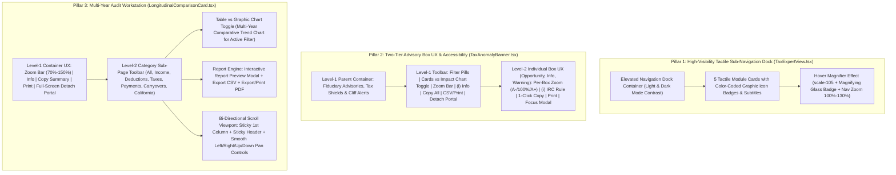

# BunBau Milestone v7.4 Implementation Plan: High-Visibility Sub-Navigation, Two-Tier Advisory Box Accessibility & Multi-Year Audit Workstation

- **Application Version Target:** `2.7.16`
- **Build Number Target:** `Build 131`
- **Architecture Version Target:** `v2.9.9 High-Visibility Tactile Sub-Navigation, Two-Tier Advisory Box Accessibility & Multi-Year Audit Report/Chart/Scroll Workstation Architecture`
- **Date:** October 13, 2026
- **Status:** Awaiting User Approval

> [!IMPORTANT]
> **Mandatory Iteration Version Rule:** *"You also need to update the application version/build/architecture version for every iteration build."*
> Upon approval of this v7.4 plan, the application version will be incremented from `2.7.15` (`Build 130`) to **`2.7.16` (`Build 131`)** with Architecture Version **`v2.9.9 High-Visibility Tactile Sub-Navigation, Two-Tier Advisory Box Accessibility & Multi-Year Audit Report/Chart/Scroll Workstation Architecture`** across [`version.ts`](file:///Users/ivanwong/_Backup_Oracle_Laptop_ICWONG_20201105/ICWONG-LAP/ICWONG-LAP_DriveD/BunBau/bunbau-web/src/lib/version.ts) and [`package.json`](file:///Users/ivanwong/_Backup_Oracle_Laptop_ICWONG_20201105/ICWONG-LAP/ICWONG-LAP_DriveD/BunBau/bunbau-web/package.json).

---

## 1. Deep-Thinking Root-Cause Analysis of the 3 UI/UX Requirements

### 1.1 Issue (1): Sub-Page Navigation Buttons Difficult to Find in `TaxExpertView.tsx`
- **Root Cause in [`TaxExpertView.tsx`](file:///Users/ivanwong/_Backup_Oracle_Laptop_ICWONG_20201105/ICWONG-LAP/ICWONG-LAP_DriveD/BunBau/bunbau-web/src/components/tax/TaxExpertView.tsx#L273-L298):**
  - The 5 primary workspace module buttons (`Overview & KPIs`, `Forward-Looking Life Planner`, `Multi-Year Audit`, `Document Vault & Viewer`, `Portfolio Tax Strategy`) are rendered inside a flat `border-b` row as small `px-3.5 py-2 rounded-xl text-xs` buttons with `15px` monochrome icons and muted `text-gray-600 dark:text-gray-400` text.
  - Positioned directly below the large gradient hero header and action buttons, these tiny text pills visually disappear in both Light and Dark mode, lacking tactile boundaries, color-coded graphic iconography, hover magnification, or accessibility scaling controls.

### 1.2 Issue (2): Opportunity, Info, and Alert Boxes Lack Level-1 & Level-2 Accessibility and Standardized UX (`TaxAnomalyBanner.tsx`)
- **Root Cause in [`TaxAnomalyBanner.tsx`](file:///Users/ivanwong/_Backup_Oracle_Laptop_ICWONG_20201105/ICWONG-LAP/ICWONG-LAP_DriveD/BunBau/bunbau-web/src/components/tax/TaxAnomalyBanner.tsx#L37-L112):**
  - The 4 executive fiduciary advisories (`Active Capital Loss Shield ($168,266)`, `Suspended Passive Rental Loss ($44,500)`, `2026 Estimated Tax Safe Harbor ($64,615)`, `IRMAA Tier 1 Cliff Buffer ($15,612 Remaining)`) contain dense statutory analysis and action advice in `text-xs` font, but are rendered as bare `
` banners.
  - There is **no Level-1 parent wrapper container** (no section zoom bar, no `(i)` methodology explainer, no visual chart comparison toggle, no bulk copy/download/print, and no fullscreen portal detach).
  - There is **no Level-2 UX toolbar** on each individual Opportunity, Info, or Warning box (no per-box zoom in/out for easier reading, no per-box `(i)` statutory citation breakdown, no one-click copy of that box's text, no single-box print/download, and no focused reader modal).

### 1.3 Issue (3): Multi-Year Audit (`LongitudinalComparisonCard.tsx`) Missing Level-1/Level-2 Accessibility, Report Generator (CSV/PDF/Preview), Category Graphic Chart Toggle, and Bi-Directional Table Scrolling
- **Root Cause in [`LongitudinalComparisonCard.tsx`](file:///Users/ivanwong/_Backup_Oracle_Laptop_ICWONG_20201105/ICWONG-LAP/ICWONG-LAP_DriveD/BunBau/bunbau-web/src/components/tax/LongitudinalComparisonCard.tsx#L254-L461) & [`SmartTable.tsx`](file:///Users/ivanwong/_Backup_Oracle_Laptop_ICWONG_20201105/ICWONG-LAP/ICWONG-LAP_DriveD/BunBau/bunbau-web/src/components/common/SmartTable.tsx#L107-L181):**
  1. **Incomplete Level-1 Container Toolbar:** The outer `9-Year Longitudinal Tax Trajectory & Historical Audit (2016 – 2025)` container (lines 254–340) lacks `AccessibilityZoomBar` (Zoom In/Out/Reset), `Detach / Full-Screen` (`createPortal`), `Download`, and `Print`.
  2. **Missing Level-2 Sub-Page Standardized UX Toolbar:** The category sub-pages (`All`, `Income`, `Deductions`, `Taxes`, `Payments`, `Carryovers`, `California`) at lines 419–460 only render category filter pills and a search input. They have no Level-2 UX toolbar for Zoom In/Out, Detach, Download, Copy, Print, or Category Info (`(i)`).
  3. **Missing Multi-Year Audit Report Option (CSV, PDF & Interactive Report Preview):** There is no `Report` action button on the Multi-Year Audit sub-page to preview a formatted multi-year audit report modal or export the active filtered matrix to CSV / PDF.
  4. **Missing Detailed Table vs. Graphic Chart Toggle:** While individual line item modals have a small chart, the Multi-Year Audit sub-page (`All`, `Income`, `Deductions`, `Taxes`, `Payments`, `Carryovers`, `California`) has no toggle to switch between the **Detailed Table View** and a **Multi-Year Comparative Graphic Chart View** comparing year-to-year audit trajectories across 2016–2025.
  5. **Right-Side Table Truncation Bug (Unscrollable Matrix):** The outer card in [`LongitudinalComparisonCard.tsx`](file:///Users/ivanwong/_Backup_Oracle_Laptop_ICWONG_20201105/ICWONG-LAP/ICWONG-LAP_DriveD/BunBau/bunbau-web/src/components/tax/LongitudinalComparisonCard.tsx#L255) has `overflow-hidden`, and [`SmartTable.tsx`](file:///Users/ivanwong/_Backup_Oracle_Laptop_ICWONG_20201105/ICWONG-LAP/ICWONG-LAP_DriveD/BunBau/bunbau-web/src/components/common/SmartTable.tsx#L123) renders `<table className="w-full">` without an `overflow-x-auto` scroll container or sticky first column. Because a 9-year audit table has **12 columns** (`Line Item` + `2016..2025` + `CAGR` + `Source PDF`), the right-side columns (`2024`, `2025`, `CAGR (9 Yrs)`, `Source PDF`) are clipped and unreachable when the left application sidebar is expanded.

---

## 2. Architectural Design & Implementation Plan

---

### Pillar 1: High-Visibility Tactile Sub-Page Navigation Bar (`src/components/tax/TaxExpertView.tsx`)

1. **Elevated Navigation Dock Container:**
   - Replace the flat `border-b` tab row (lines 273–298 of [`TaxExpertView.tsx`](file:///Users/ivanwong/_Backup_Oracle_Laptop_ICWONG_20201105/ICWONG-LAP/ICWONG-LAP_DriveD/BunBau/bunbau-web/src/components/tax/TaxExpertView.tsx)) with a high-visibility **Tax Fiduciary Workspace Navigation Dock**:
     - Container styling: `p-3 rounded-2xl bg-gradient-to-r from-slate-100 via-white to-slate-100 dark:from-slate-900 dark:via-slate-800/95 dark:to-slate-900 border-2 border-slate-300/80 dark:border-slate-700 shadow-md`.
     - Top mini-bar inside the dock with a clear label (`WORKSPACE NAVIGATION MODULES`) and a **Nav Bar Accessibility Controls** strip:
       - **Nav Bar Zoom (`AccessibilityZoomBar`)**: Allows scaling the navigation buttons from `90%` to `135%`.
       - **Hover Magnifier Lens Toggle (`Magnify on Hover: ON/OFF`, default `ON`)**: With a `Search` / `ZoomIn` icon badge indicating active mouse-over magnification.
2. **Tactile Card-Style Module Buttons with Color-Coded Graphic Icons:**
   - Render the 5 modules in a responsive 5-column tactile grid (`grid grid-cols-1 sm:grid-cols-2 lg:grid-cols-5 gap-2.5`):
     1. **`Overview & KPIs`**: Violet/Indigo icon badge (`Sparkles`), subtitle `"KPIs, Alerts & 1040/540"`.
     2. **`Forward-Looking Life Planner`**: Emerald/Teal icon badge (`Compass`), subtitle `"2026–2040 Milestones"`.
     3. **`Multi-Year Audit`**: Blue/Cyan icon badge (`Layers`), subtitle `"9-Year Trajectory (2016–2025)"`.
     4. **`Document Vault & Viewer`**: Amber/Orange icon badge (`FolderOpen`), subtitle `"9 Filed PDFs & Form Sheets"`.
     5. **`Portfolio Tax Strategy`**: Rose/Purple icon badge (`LineChart`), subtitle `"Tax Drag & Loss Shields"`.
3. **Mouse-Over Magnification & Light/Dark Mode High-Contrast Styling:**
   - **Hover Magnification:** When hovering over any module button, apply `hover:scale-[1.05] hover:-translate-y-1 hover:z-20 hover:shadow-xl transition-all duration-200 ease-out` along with a floating magnifier indicator (`ZoomIn` badge) in the top-right corner of the hovered button so the button enlarges clearly under the mouse pointer.
   - **Active Tab State:** Vibrant gradient card (`bg-gradient-to-br from-primary-violet via-indigo-600 to-purple-700 text-white border-2 border-primary-mint shadow-lg ring-2 ring-primary-violet/40`), white icon badge, bold `text-sm` title, and an `ACTIVE` status pill.
   - **Inactive Tab State:** Crisp high-contrast card (`bg-white dark:bg-slate-800/95 text-slate-900 dark:text-white border-2 border-slate-200 dark:border-slate-700 hover:border-primary-violet dark:hover:border-primary-mint`), distinct tinted icon container, and clear `text-sm font-extrabold` typography.

---

### Pillar 2: Two-Tier Standardized UX & Accessibility for Opportunity, Info, and Alert Boxes (`src/components/tax/TaxAnomalyBanner.tsx`)

1. **Tier 1 — Level-1 Wrap Container (`Fiduciary Advisories, Tax Shields & Cliff Alerts`):**
   - Wrap all anomaly/advisory boxes in [`TaxAnomalyBanner.tsx`](file:///Users/ivanwong/_Backup_Oracle_Laptop_ICWONG_20201105/ICWONG-LAP/ICWONG-LAP_DriveD/BunBau/bunbau-web/src/components/tax/TaxAnomalyBanner.tsx) inside a canonical Level-1 container card (`data-testid="tax-anomaly-banner"`):
     - **Header Title & Summary Badges:** Displays count of active `Opportunities`, `Warnings`, and `Info` advisories.
     - **Severity Filter Pills:** `All`, `Opportunity`, `Warning`, `Info` filter buttons.
     - **Level-1 Standardized UX Toolbar:**
       - **View Toggle (`Advisory Cards` vs. `Impact Chart`):** Switches between the advisory cards and a visual **Financial Shield & Cliff Magnitude Bar Chart** comparing dollar impacts across the advisories (`$168,266` Capital Loss Shield, `$44,500` Passive Rental Loss, `$64,615` Safe Harbor Target, `$15,612` IRMAA Buffer).
       - **Level-1 `AccessibilityZoomBar` (`70%` – `150%`):** Scales the entire advisory container (`data-testid="anomaly-container-zoom-bar"`).
       - **Level-1 `(i)` Info Explainer (`data-testid="anomaly-container-info-btn"`):** Toggles an executive explanation of the statutory rules governing Opportunity, Warning, and Info advisories.
       - **One-Click Copy All (`data-testid="anomaly-container-copy-btn"`):** Copies all visible advisories and action items to clipboard.
       - **Download CSV/Report (`data-testid="anomaly-container-download-btn"`):** Downloads a CSV/Markdown advisory report (`BunBau_Tax_Advisories_2025.csv`).
       - **Print (`data-testid="anomaly-container-print-btn"`):** Triggers print view.
       - **Detach / Full-Screen (`data-testid="anomaly-container-detach-btn"`):** Renders the entire Advisory container in a full-screen `createPortal(..., document.body)` modal.

2. **Tier 2 — Level-2 Standardized UX Toolbar on Every Individual Box (`OPPORTUNITY`, `INFO`, `WARNING`):**
   - Enhance each individual box (`data-testid="anomaly-${a.id}"`) with its own **Level-2 UX Control Bar** in the card header:
     - **Per-Box `AccessibilityZoomBar` (`compact` variant, `70%` – `150%`):** Allows the user to zoom in on a single Opportunity, Info, or Warning box independently (`data-testid="anomaly-box-zoom-${a.id}"`) so dense text becomes large and effortless to read.
     - **Per-Box `(i)` Statutory Rule Explainer (`data-testid="anomaly-box-info-${a.id}"`):** Opens an inline statutory breakdown showing the exact IRS/FTB form reference, IRC statutory authority (e.g., IRC §1212(b), IRC §469, IRC §6654(d)(1)(B), Social Security Act §1839(i)), and calculation provenance.
     - **Per-Box Chart / Metric Breakdown Toggle (`data-testid="anomaly-box-chart-${a.id}"`):** Toggles an inline mini visual progress/comparison bar inside that box (e.g., comparing 2024 vs. 2025 carryover or MAGI vs. IRMAA cliff threshold).
     - **Per-Box One-Click Copy (`data-testid="anomaly-box-copy-${a.id}"`):** Copies that single box's title, description, and fiduciary action advice with `Copied!` confirmation.
     - **Per-Box Download & Print (`data-testid="anomaly-box-download-${a.id}"`, `data-testid="anomaly-box-print-${a.id}"`):** Exports or prints that specific advisory.
     - **Per-Box Detach / Reader Modal (`data-testid="anomaly-box-detach-${a.id}"`):** Opens that single advisory box in a dedicated, high-contrast large-print reader modal via `createPortal`.

---

### Pillar 3: Multi-Year Audit (`src/components/tax/LongitudinalComparisonCard.tsx`) Level-1 & Level-2 UX, Report Engine (CSV/PDF/Preview), Category Graphic Chart Toggle, & Bi-Directional Scrollable Matrix

1. **Level-1 Container UX Completion (`9-Year Longitudinal Tax Trajectory & Historical Audit`):**
   - Upgrade the top header toolbar of [`LongitudinalComparisonCard.tsx`](file:///Users/ivanwong/_Backup_Oracle_Laptop_ICWONG_20201105/ICWONG-LAP/ICWONG-LAP_DriveD/BunBau/bunbau-web/src/components/tax/LongitudinalComparisonCard.tsx#L258-L340) to include the complete BunBau Level-1 UX suite:
     - **Level-1 `AccessibilityZoomBar` (`70%` – `150%`, `testIdPrefix="longitudinal-level1"`):** Scales the entire Multi-Year Audit card.
     - **Level-1 `(i)` Info Button:** Existing methodology banner toggle.
     - **Level-1 `Copy Summary` Button:** Existing one-click summary copy.
     - **Level-1 `Download CSV` Button (`data-testid="longitudinal-level1-download-btn"`):** Exports the full 9-year dataset.
     - **Level-1 `Print` Button (`data-testid="longitudinal-level1-print-btn"`):** Prints the longitudinal audit.
     - **Level-1 `Detach / Full-Screen` Button (`data-testid="longitudinal-level1-detach-btn"`):** Renders the entire `LongitudinalComparisonCard` in a full-viewport `createPortal` modal (`fixed inset-0 z-50`) with Escape key and backdrop close support.

2. **Level-2 Sub-Page Standardized UX Toolbar (`All`, `Income`, `Deductions`, `Taxes`, `Payments`, `Carryovers`, `California`):**
   - Wrap the category sub-page workspace (`activeViewMode === 'matrix'`, plus support in `macro` and `shields`) in a dedicated **Level-2 Sub-Page Container** (`data-testid="longitudinal-subpage-container"`) featuring:
     - **Category Filter Pills (`All`, `Income`, `Deductions`, `Taxes`, `Payments`, `Carryovers`, `California`)** with item count badges (e.g., `All (16)`, `Income (6)`, `Deductions (2)`, etc.).
     - **Level-2 Standardized UX Action Bar (`data-testid="longitudinal-subpage-toolbar"`):**
       1. **`Table` vs. `Graphic Chart` Toggle (`data-testid="subpage-view-table-btn"`, `data-testid="subpage-view-chart-btn"`):**
          - Switches the active sub-page (`All`, `Income`, `Deductions`, `Taxes`, `Payments`, `Carryovers`, `California`) between the **Detailed Multi-Year Table** and an interactive **Multi-Year Category Graphic Chart**.
          - In **Graphic Chart** mode (`data-testid="subpage-category-chart"`): Renders a rich comparative multi-year visual chart across all 9 tax years (`2016–2025`) for the line items in the selected category (`All`, `Income`, `Deductions`, etc.), allowing users to compare primary line items side-by-side per year with interactive line-item series toggles, 2024 vs. 2025 delta callouts, CAGR badges, and click-to-inspect bars.
       2. **`Report` Button & Interactive Report Preview Modal (`data-testid="subpage-report-btn"`, `data-testid="subpage-export-csv-btn"`, `data-testid="subpage-export-pdf-btn"`):**
          - **`Report Preview` (`Report` button):** Opens a dedicated **Multi-Year Audit Report Preview Modal** (`createPortal`, `data-testid="multi-year-audit-report-modal"`) for the active filter (`All`, `Income`, `Deductions`, etc., with an in-modal filter switcher):
            - Displays an executive report header (`BUNBAU FIDUCIARY 9-YEAR LONGITUDINAL TAX AUDIT REPORT (2016 – 2025) — Filter: [Category]`), taxpayer metadata (`Harmony Wong & Ivan Wong • MFJ`), macro KPI summary strip, the complete multi-year comparative graphic chart, and the full 9-year line-item audit table.
            - Includes one-click **`Download CSV`**, **`Download / Print PDF`** (formatted print/PDF stylesheet + clean HTML report export), **`Copy Full Report`**, and **`AccessibilityZoomBar`** inside the report preview modal.
          - Direct **`CSV`** and **`PDF`** quick action buttons on the Level-2 toolbar for immediate export.
       3. **Level-2 `AccessibilityZoomBar` (`testIdPrefix="longitudinal-subpage"`):** Scales the active sub-page table/chart (`70%` – `150%`) independently of the outer card.
       4. **Level-2 `(i)` Category Info Button (`data-testid="subpage-info-btn"`):** Displays a contextual statutory explanation specific to the selected filter (`All`, `Income`, `Deductions`, `Taxes`, `Payments`, `Carryovers`, `California`).
       5. **Level-2 One-Click `Copy Table` Button (`data-testid="subpage-copy-btn"`):** Copies the active filtered sub-page matrix (headers + all 2016–2025 values + CAGR) to clipboard.
       6. **Level-2 `Detach / Full-Screen Sub-Page` Button (`data-testid="subpage-detach-btn"`):** Opens the detailed category sub-page (`All`, `Income`, `Deductions`, etc.) in its own full-screen `createPortal` workstation window so the user can inspect all 12 columns at 100% viewport width.

3. **Bi-Directional Scrollable Matrix Viewport & Right-Side Truncation Fix (`LongitudinalComparisonCard.tsx` & `SmartTable.tsx`):**
   - **Root Fix for Right-Side Truncation:**
     - Enhance [`SmartTable.tsx`](file:///Users/ivanwong/_Backup_Oracle_Laptop_ICWONG_20201105/ICWONG-LAP/ICWONG-LAP_DriveD/BunBau/bunbau-web/src/components/common/SmartTable.tsx) (or provide a scrollable viewport wrapper prop `scrollableViewportClassName` / `tableContainerRef` and sticky first-column support) so wide tables are wrapped in a `relative w-full overflow-x-auto overflow-y-auto` scroll container with `min-w-max` on the `<table>` element.
     - **Sticky First Column (`Line Item & IRS Form Reference`):** Apply `sticky left-0 z-20 bg-white dark:bg-slate-950 shadow-[2px_0_6px_-2px_rgba(0,0,0,0.12)]` to the first column header and cells so that as the user scrolls right to view `2022`, `2023`, `2024`, `2025`, `CAGR (9 Yrs)`, and `Source PDF`, the line item name and `Inspect` button remain locked in view on the left.
     - **Sticky Table Header (`thead`):** Keep the year headers (`2016` – `2025`, `CAGR`, `Source PDF`) pinned at the top (`sticky top-0 z-30`) during vertical scrolling.
     - **Interactive Scroll / Pan Navigation Bar (`← Left` | `Right →` | `↑ Top` | `↓ Bottom`):**
       - Add explicit, accessible scroll control buttons (`data-testid="matrix-scroll-left"`, `data-testid="matrix-scroll-right"`, `data-testid="matrix-scroll-top"`, `data-testid="matrix-scroll-bottom"`) right above the table header so users can click to pan smoothly left/right across the 9 tax years and CAGR/Source columns or use native trackpad/scrollbar scrolling in every category (`All`, `Income`, `Deductions`, `Taxes`, `Payments`, `Carryovers`, `California`).

---

## 3. Files to Be Modified & Created

| File | Action | Summary of Changes |
| :--- | :--- | :--- |
| [`src/components/tax/TaxExpertView.tsx`](file:///Users/ivanwong/_Backup_Oracle_Laptop_ICWONG_20201105/ICWONG-LAP/ICWONG-LAP_DriveD/BunBau/bunbau-web/src/components/tax/TaxExpertView.tsx) | **Modify** | Replace the small flat sub-page tab strip with the **High-Visibility Tactile Sub-Navigation Dock** featuring larger typography, color-coded graphic icon badges, module subtitles, hover magnification (`hover:scale-[1.05]` + magnifier indicator), nav accessibility zoom bar, and high-contrast Light/Dark mode themes. |
| [`src/components/tax/TaxAnomalyBanner.tsx`](file:///Users/ivanwong/_Backup_Oracle_Laptop_ICWONG_20201105/ICWONG-LAP/ICWONG-LAP_DriveD/BunBau/bunbau-web/src/components/tax/TaxAnomalyBanner.tsx) | **Modify** | Implement **Two-Tier Standardized UX & Accessibility**: (1) Level-1 Wrap Container with severity filter pills, Cards vs. Impact Chart toggle, Level-1 Zoom Bar, `(i)` Info, Copy All, CSV Download, Print, and Portal Detach; (2) Level-2 UX bar on each individual Opportunity/Info/Warning card with per-card Zoom (`A-/100%/A+`), `(i)` statutory rule popover, mini chart toggle, one-click Copy, Print/Download, and Focus Reader Modal. |
| [`src/components/tax/LongitudinalComparisonCard.tsx`](file:///Users/ivanwong/_Backup_Oracle_Laptop_ICWONG_20201105/ICWONG-LAP/ICWONG-LAP_DriveD/BunBau/bunbau-web/src/components/tax/LongitudinalComparisonCard.tsx) | **Modify** | Implement (1) Level-1 Container Zoom Bar, Print, Download & Full-Screen Detach Portal; (2) Level-2 Sub-Page UX Toolbar for all filters (`All`, `Income`, `Deductions`, `Taxes`, `Payments`, `Carryovers`, `California`) with Zoom, Info, Copy, Print, and Sub-Page Detach; (3) **Table vs. Graphic Chart Toggle** for filtered category sub-pages; (4) **Multi-Year Audit Report Engine** (Interactive Report Preview Modal + CSV Export + PDF/Print Export); and (5) **Bi-Directional Scrollable Matrix Viewport** with sticky first column and Left/Right/Up/Down pan controls. |
| [`src/components/common/SmartTable.tsx`](file:///Users/ivanwong/_Backup_Oracle_Laptop_ICWONG_20201105/ICWONG-LAP/ICWONG-LAP_DriveD/BunBau/bunbau-web/src/components/common/SmartTable.tsx) | **Modify** | Support optional `scrollContainerRef`, `maxHeightClassName`, `stickyFirstColumn`, and horizontal/vertical scroll wrapper (`overflow-x-auto overflow-y-auto`) so wide multi-column tables never clip or truncate right-hand columns. |
| [`src/lib/version.ts`](file:///Users/ivanwong/_Backup_Oracle_Laptop_ICWONG_20201105/ICWONG-LAP/ICWONG-LAP_DriveD/BunBau/bunbau-web/src/lib/version.ts) & [`package.json`](file:///Users/ivanwong/_Backup_Oracle_Laptop_ICWONG_20201105/ICWONG-LAP/ICWONG-LAP_DriveD/BunBau/bunbau-web/package.json) | **Modify** | Bump version to `2.7.16`, `Build 131`, and Architecture Version `v2.9.9 High-Visibility Tactile Sub-Navigation, Two-Tier Advisory Box Accessibility & Multi-Year Audit Report/Chart/Scroll Workstation Architecture`. |
| [`src/components/tax/__tests__/v74UiAccessibilityAndAuditWorkstation.test.tsx`](file:///Users/ivanwong/_Backup_Oracle_Laptop_ICWONG_20201105/ICWONG-LAP/ICWONG-LAP_DriveD/BunBau/bunbau-web/src/components/tax/__tests__/v74UiAccessibilityAndAuditWorkstation.test.tsx) | **Create** | Automated Vitest verification suite covering the redesigned high-visibility navigation dock, Level-1 & Level-2 UX controls on `TaxAnomalyBanner`, and Level-1 & Level-2 UX controls, Report Preview/CSV/PDF, Category Graphic Chart toggle, and bi-directional scrolling across all category filters (`All`, `Income`, `Deductions`, `Taxes`, `Payments`, `Carryovers`, `California`) in `LongitudinalComparisonCard`. |

---

## 4. Verification & Acceptance Criteria

1. **High-Visibility Sub-Page Navigation (`TaxExpertView.tsx`):**
   - All 5 module buttons render inside an unmistakable Tactile Navigation Dock with graphic icon badges, subtitles, hover magnification (`hover:scale-[1.05]`), navigation zoom bar, and high-contrast Light/Dark mode styling.
2. **Opportunity, Info, and Alert Boxes (`TaxAnomalyBanner.tsx`):**
   - Level-1 wrapper container provides Zoom In/Out, `(i)` Info, Cards vs. Chart toggle, Copy All, Download CSV, Print, and Fullscreen Detach.
   - Each individual Opportunity, Info, and Warning box provides Level-2 per-box Zoom In/Out, `(i)` statutory explanation, one-click Copy, Download/Print, and Focus Reader Modal.
3. **Multi-Year Audit (`LongitudinalComparisonCard.tsx`):**
   - Outer Level-1 container includes Zoom In/Out, Info, Copy Summary, Download, Print, and Full-Screen Detach.
   - Category sub-pages (`All`, `Income`, `Deductions`, `Taxes`, `Payments`, `Carryovers`, `California`) include a Level-2 UX toolbar with Zoom In/Out, Info, Copy, Detach, **Table vs. Graphic Chart toggle**, **Report Preview Modal + CSV/PDF export**, and **Bi-Directional Horizontal/Vertical Scrolling** (sticky first column + Left/Right/Up/Down pan controls) so right-side columns (`2024`, `2025`, `CAGR`, `Source PDF`) are never truncated.
4. **Zero Regressions & Full Test Suite Pass:**
   - 100% pass rate across all existing and new Vitest test suites plus clean `npm run build` compilation.
