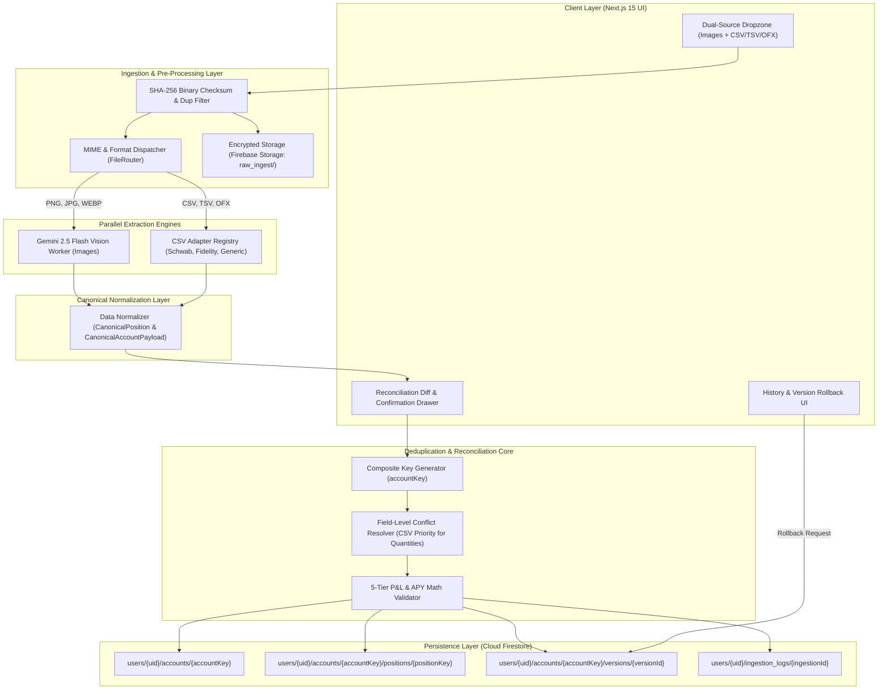
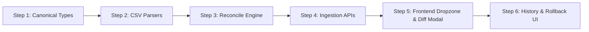

# BunBau (資本寶) v2.8.1 — Dual-Source Data Ingestion Pipeline: Architecture, Traceability Matrix, Regression Suite & Automated Test Plan

**Document Version:** v2.8.1-PLAN  
**Date:** October 7, 2026  
**Status:** ⏳ **READ-ONLY PLANNING PHASE (Awaiting User Review & Approval)**  
**Target Runtime:** Node.js 20 / Next.js 15 (App Router) / Google Cloud Run / Firebase Firestore & Storage  
**Author:** AI Pair Programmer (DeepMind Antigravity)

---

## Executive Overview & Architectural Intent

BunBau currently parses portfolio holdings via screenshot visual extraction with Gemini 2.5 Flash Vision (`/api/extract`). While effective for top-level account snapshots, screenshot extraction faces inherent domain limits:
- **Occluded Tables:** Large portfolios spanning multiple scroll viewports cannot be captured in a single frame.
- **Missing Lot Details:** Cost basis tax-lot breakdowns, option Greeks, exact coupon maturity dates, and settled cash balances are frequently truncated on mobile displays.
- **Strategy Math Discrepancies:** BunBau’s Strategy & Rebalancing engine requires mathematically exact cost basis and option strike data to reliably compute Cash-Secured Put reserves, Covered Call lockups, and yield gap simulations.

To solve this, BunBau is upgrading to a **Dual-Source Data Ingestion Pipeline** supporting both raw **brokerage screenshots** AND **exported brokerage CSV/OFX files** (Charles Schwab, Fidelity, Webull, Citi, etc.).

### Non-Negotiable Architectural Rules:
1. **Source Independence:** The pipeline functions with 100% autonomy whether a user uploads *only* a CSV, *only* screenshots, or *both* simultaneously or asynchronously.
2. **Deterministic Deduplication:** Matching is governed by mathematical composite keys:
   $$\text{accountKey} = \text{MD5}(\text{userId} + \text{institutionNormalized} + \text{accountMaskedNumber})$$
   $$\text{positionKey} = \text{MD5}(\text{accountKey} + \text{symbolNormalized} + \text{assetCategory} + (\text{maturityOrExpiryDate} \parallel \text{"NA"}))$$
   **Zero Double-Counting Guarantee:** Positions and cash balances are never duplicated or doubled.
3. **Complementary Enrichment:** High-precision CSV data (cost basis, fractional shares, contract terms) reconciles with screenshot visual state (unsettled cash drag, raw portfolio equity).
4. **Auditability, Lineage & Rollback:** Binary `SHA-256` checksums prevent duplicate processing; line items track provenance (`SCREENSHOT` | `CSV` | `MERGED`); accounts maintain immutable snapshot versioning (`version: n + 1`) with 1-click rollback.
5. **Zero Breaking Changes:** Existing Dashboard, Calendar, Strategy, and History selectors continue operating seamlessly on the unified `CanonicalPosition` contract.

---

# SECTION 1: Architectural & Component Design



---

### 1.1 File Parsing & Classification Layer (`FileRouter` & Adapters)

To prevent breaking existing functionality, existing `/api/extract` is preserved as a dedicated image extraction endpoint. The new dual-source capabilities are housed under modular, versioned routes:
- `POST /api/v1/ingest/upload`
- `POST /api/v1/ingest/confirm`
- `GET /api/v1/ingest/history`
- `POST /api/v1/ingest/rollback`

#### A. File Dispatcher (`FileRouter`)
1. **Binary Checksum:** For each file in `multipart/form-data`, compute `SHA-256(fileBuffer)`.
2. **Duplicate Check:** Query `users/{uid}/ingestion_logs` where `fileHash == computedHash` and `status == 'MERGED'`. If matched, return a 409 warning to prevent redundant processing.
3. **MIME Detection:**
   - Images (`image/png`, `image/jpeg`, `image/webp`): Sent to `VisionWorker`.
   - Tabular (`text/csv`, `text/tab-separated-values`, `.ofx`, `.csv`): Sent to `CSVParserRegistry`.

#### B. CSV Parser Adapter Registry (`src/lib/ingestion/adapters/`)
The parser layer implements a pluggable adapter pattern with signature detection:

```typescript
export interface CSVAdapter {
  id: string;
  name: string;
  canHandle(headers: string[], firstRows: string[][], rawText: string): boolean;
  parse(rawText: string): Promise<RawParsedAccount[]>;
}
```

1. **`SchwabCSVAdapter` (`schwab.ts`):**
   - **Detection Trigger:** Headers contain `"Positions for account"`, `"Symbol"`, `"Description"`, `"Quantity"`, `"Price"`, `"Amount"`, `"Cost Basis"`.
   - **Cash Line Item:** Maps rows with `"Cash & Cash Investments"` to `AssetCategory: "Cash"`.
   - **CD & Bond Extraction:** Rows containing `"CERTIFICATE OF DEPOSIT"`, `"CD"`, or coupon rates parse as `AssetCategory: "CD"`. Extracts maturity date via regex `\b\d{2}/\d{2}/\d{4}\b` and calculates APY from description string.
   - **Option Rows:** Parses options symbols (e.g. `AAPL 10/16/2026 310.00 P`) into strike `$310.00`, expiry `2026-10-16`, right `PUT`.
2. **`FidelityCSVAdapter` (`fidelity.ts`):**
   - **Detection Trigger:** Headers contain `"Account number"`, `"Account name"`, `"Symbol"`, `"Description"`, `"Quantity"`, `"Last price"`, `"Current value"`, `"Cost basis total"`.
   - **Cash Aggregation:** Aggregates core cash (`"FCASH**"`, `"SPAXX**"`, or `"HELD IN FCASH"`) with `"Pending activity"` into total gross cash (e.g., in user's file: `$100,098.97` + `$232.77` = **`$100,331.74`**).
   - **Options Prefix & OCC Decoding:** Handles leading dash/space option notation (`/^\s*-\s*([A-Z]+)(\d{2})(\d{2})(\d{2})([CP])(\d+(?:\.\d+)?)$/`):
     - ` -AAPL261023P310` $\to$ Underlier `AAPL`, Expiration `2026-10-23`, `PUT`, Strike `$310.00`.
     - ` -MSFT261023P475` $\to$ Underlier `MSFT`, Expiration `2026-10-23`, `PUT`, Strike `$475.00`.
     - ` -NVDA261106P200` $\to$ Underlier `NVDA`, Expiration `2026-11-06`, `PUT`, Strike `$200.00`.
     - ` -SLV261016C68` $\to$ Underlier `SLV`, Expiration `2026-10-16`, `CALL`, Strike `$68.00`, Qty `-2`.
     - ` -T261120C28` $\to$ Underlier `T`, Expiration `2026-11-20`, `CALL`, Strike `$28.00`, Qty `-1`.
   - **Collateral & Free Cash Derivation:**
     - Computes locked CSP collateral: $\$31,000 + \$47,500 + \$20,000 = \mathbf{\$98,500.00}$.
     - Computes Net Free Cash: $\$100,331.74 - \$98,500.00 = \mathbf{\$1,831.74}$.
   - **Covered Call Equity Matching:**
     - Links `-SLV261016C68` (-2 contracts) to 200 owned `SLV` shares.
     - Links `-T261120C28` (-1 contract) to 100 owned `T` shares.
   - **Numeric Sanitization:** Handles parenthesized negative values (`($78.00)`, `"($5,791.34)"`), quoted dollar amounts with commas (`"$434,329.97 "`), and fractional shares (`3000.138`).
   - **Footer & Metadata Extraction:** Safely skips multiline legal disclosures (lines 19–21) and extracts the export timestamp from `Date downloaded Oct-06-2026 9:41 p.m ET` (line 23) for snapshot provenance.
3. **`GenericFallbackAdapter` (`generic.ts`):**
   - For unlisted formats (Webull, HSBC, Bank of China, interactive brokers), invokes a structured LLM mapper (Gemini 2.5 Flash with JSON schema) to identify column mappings:
     `{ symbolCol, qtyCol, priceCol, valueCol, costBasisCol, accountCol }`.
   - Validates mathematically that $\text{Quantity} \times \text{Price} \approx \text{Market Value}$ before accepting.

---

### 1.2 Data Normalizer & Canonical Contract

All incoming data streams normalize into BunBau's unified data spine before persistence.

#### A. Canonical TypeScript Contract (`src/lib/types/ingestion.ts`)

```typescript
export type AssetCategory = 
  | 'Cash' 
  | 'CD' 
  | 'Bond_SGOV' 
  | 'Stock' 
  | 'ETF' 
  | 'Option' 
  | 'Crypto';

export type DataSourceOrigin = 'SCREENSHOT' | 'CSV' | 'MERGED' | 'MANUAL';

export interface CanonicalOptionDetails {
  underlying: string;
  type: 'CALL' | 'PUT';
  strike: number;
  expirationDate: string; // ISO 8601: YYYY-MM-DD
  isCollateralizedCsp: boolean;
  contractsCount: number;
}

export interface CanonicalPosition {
  positionKey: string;
  accountKey: string;
  symbol: string;
  description: string;
  assetCategory: AssetCategory;
  quantity: number;
  costBasis: number;
  currentPrice: number;
  marketValue: number;
  unrealizedGainLoss: number;
  unrealizedGainLossPct: number;
  yieldApy?: number;
  maturityDate?: string; // ISO 8601: YYYY-MM-DD
  optionDetails?: CanonicalOptionDetails | null;
  dataSource: DataSourceOrigin;
  updatedAt: string;
}

export interface CanonicalAccountPayload {
  accountKey: string;
  institution: string;
  accountName: string;
  accountMaskedNumber: string;
  accountType: 'Brokerage' | 'Roth IRA' | 'Traditional IRA' | '401(k)' | 'Checking' | 'Savings' | 'Crypto';
  totalValue: number;
  cashBalance: number;
  positions: CanonicalPosition[];
  rawSourceFiles: {
    fileHash: string;
    fileName: string;
    fileType: 'IMAGE' | 'CSV';
    storagePath: string;
  }[];
  sourceType: 'SCREENSHOT' | 'CSV' | 'DUAL';
  extractedAt: string;
  version: number;
}
```

#### B. Alignment with Existing BunBau Types
To guarantee zero regressions in `DashboardCharts.tsx`, `CalendarView.tsx`, and `StrategyView.tsx`:
- `assetCategory: 'Cash'` maps to `AssetClass: 'Cash'`
- `assetCategory: 'CD'` maps to `AssetClass: 'CD'`
- `assetCategory: 'Bond_SGOV'` maps to `AssetClass: 'Treasury'` or `'BondETF'`
- `assetCategory: 'Option'` maps to `AssetClass: 'CSP'` (when Put) or `'CoveredCall'` (when Call with owned equity)
- `positionKey` satisfies `CanonicalPosition.id`
- `accountKey` satisfies `CanonicalAccount.id`

---

### 1.3 Reconciliation Engine (`reconcile.ts`)

When both a Screenshot and a CSV match the same `accountKey`, the **Field-Level Conflict Resolver** merges them deterministically according to strict mathematical precedence:

| Field | Source Priority | Rationale / Rule |
| :--- | :---: | :--- |
| **Shares / Quantity** | **CSV (100%)** | CSV provides 4-decimal floating point precision without OCR visual truncation. |
| **Cost Basis & Basis/Share** | **CSV (100%)** | Brokerage screenshots frequently hide or truncate tax-lot basis behind submenus. |
| **Option Strike & Expiry** | **CSV (100%)** | Eliminates character ambiguity (e.g. OCR misreading `P` as `F` or `8` as `B`). |
| **CD / Bond Maturity Date** | **CSV $\to$ Screenshot** | If CSV contains maturity date, use CSV. If CSV is generic but screenshot table explicitly shows maturity date, **screenshot enriches the missing CSV field**. |
| **CD / Treasury APY%** | **CSV $\to$ Screenshot** | Uses exact stated percentage from export or OCR. |
| **Raw Cash & Net Worth** | **Screenshot $\to$ CSV** | If CSV is a previous-day export while screenshot captures live midday execution, screenshot takes precedence for live liquidity, subject to user diff preview confirmation. |
| **CSP Collateral Lock** | **Calculated** | $\text{Collateral} = \text{Strike} \times 100 \times \text{Contracts}$. Automatically deducted from Gross Cash to derive **Net Free Cash**. |
| **Lineage Tracking** | **MERGED** | Output record tagged with `dataSource: 'MERGED'` and links both file SHA-256 hashes. |

#### Idempotent Position Match Formula
$$\text{positionKey} = \text{MD5}(\text{accountKey} + \text{symbolNormalized} + \text{assetCategory} + (\text{maturityOrExpiryDate} \parallel \text{"NA"}))$$
Because existing positions are updated by their deterministic `positionKey`, **positions are updated in-place and never duplicated**.

---

### 1.4 Cloud Firestore Database Schema Extension

The database maintains user isolation, audit history, and point-in-time versioning:

```
firestore/
├── users/
│   └── {userId}/
│       ├── profile/
│       │   └── settings (doc)
│       ├── accounts/
│       │   └── {accountKey}/                 <-- MD5(userId + institution + accountMaskedNumber)
│       │       ├── metadata (doc)           <-- Active totals, version, lastIngestionId, updatedAt
│       │       ├── positions/
│       │       │   └── {positionKey} (doc)  <-- Only ACTIVE current holdings
│       │       └── versions/
│       │           └── {versionId} (doc)    <-- Immutable archive snapshot of prior imports
│       ├── ingestion_logs/
│       │   └── {ingestionId}/               <-- Audit log per upload event
│       │       ├── fileHash: string         <-- SHA-256 of uploaded file
│       │       ├── fileName: string
│       │       ├── fileType: 'CSV' | 'SCREENSHOT'
│       │       ├── status: 'PENDING' | 'MERGED' | 'REJECTED'
│       │       ├── storagePath: string      <-- Cloud Storage reference
│       │       ├── matchedAccountKeys: string[]
│       │       ├── versionGenerated: number
│       │       └── createdAt: timestamp
│       └── snapshots/                       <-- Portfolio-wide historical net worth snapshots
│           └── {snapshotId} (doc)
```

---

# SECTION 2: Phased Implementation Plan



### Step 1: Types & Canonical Data Contracts (`src/lib/types/ingestion.ts`)
- Implement `AssetCategory`, `DataSourceOrigin`, `CanonicalOptionDetails`, `CanonicalPosition`, and `CanonicalAccountPayload`.
- Add converter utility functions:
  - `toLegacyPosition(pos: CanonicalPosition): import('../portfolio/types').CanonicalPosition`
  - `toCanonicalAccount(account: import('../portfolio/types').CanonicalAccount): CanonicalAccountPayload`
- **Zero Breakage Guarantee:** Existing `src/lib/portfolio/types.ts` is preserved. Converters provide seamless two-way compatibility with existing UI selectors.

### Step 2: Deterministic CSV Parsers & Adapters (`src/lib/ingestion/adapters/`)
- `src/lib/ingestion/adapters/csvParser.ts`: Zero-dependency, RFC 4180 compliant CSV parser handling quoted multiline cells, commas in dollar amounts, and escaped quotes.
- `src/lib/ingestion/adapters/schwabAdapter.ts`: Parses Schwab positions, cash balances, CDs, and options.
- `src/lib/ingestion/adapters/fidelityAdapter.ts`: Parses Fidelity positions, core cash (`SPAXX`), and OCC option notations.
- `src/lib/ingestion/adapters/genericAdapter.ts`: Fallback parser with Gemini 2.5 Flash column mapping inference.
- `src/lib/ingestion/adapters/router.ts`: Header signature detection router that inspects file content and selects the appropriate adapter automatically.

### Step 3: Deduplication & Field Merge Engine (`src/lib/ingestion/reconcile.ts`)
- `src/lib/ingestion/hasher.ts`: Computes binary `SHA-256` hashes for file duplicate detection.
- `src/lib/ingestion/keys.ts`: Generates deterministic `accountKey` and `positionKey`.
- `src/lib/ingestion/reconcile.ts`: Implements the 5 field-level precedence rules. Compares candidate positions from Screenshot and CSV:
  - Merges duplicate positions into a single enriched position tagged `MERGED`.
  - Computes field-level diffs (`diffSummary`) for display in the review modal.
  - Recalculates cash reserves and gross/net portfolio values.

### Step 4: Unified Ingestion API Endpoints (`src/app/api/v1/ingest/`)
- `src/app/api/v1/ingest/upload/route.ts`:
  - Accepts `multipart/form-data` with multiple files (images, CSVs, or mixed).
  - Calculates SHA-256 hashes and archives raw files to Firebase Storage (`raw_ingest/{timestamp}_{fileName}`).
  - Dispatches images to Gemini Vision and CSVs to `CSVRouter`.
  - Runs `reconcile()` across extracted accounts.
  - Returns staged payload `{ stagingId, accounts, diffs, warnings }` without committing to Firestore yet.
- `src/app/api/v1/ingest/confirm/route.ts`:
  - Accepts `{ stagingId, confirmedAccounts }`.
  - Opens Firestore atomic `writeBatch`:
    1. Archives existing active positions to `accounts/{accountKey}/versions/v_{version}`.
    2. Writes new/merged positions into `accounts/{accountKey}/positions/{positionKey}`.
    3. Increments account `metadata.version` ($N+1$).
    4. Writes audit entry to `ingestion_logs/{ingestionId}` with status `MERGED`.
  - Returns `{ success: true, updatedAccountKeys: string[] }`.
- `src/app/api/v1/ingest/history/route.ts`:
  - Retrieves chronological list of all ingestion logs and versions per account.
- `src/app/api/v1/ingest/rollback/route.ts`:
  - Reverts account holdings to a specified prior version document atomically.

### Step 5: Frontend Dual-Uploader & Diff Preview Modal (`src/components/ingest/`)
- `src/components/ingest/DualSourceUploader.tsx`:
  - Drag-and-drop zone accepting both images (`.png, .jpg, .webp`) and tabular exports (`.csv, .tsv, .ofx`).
  - File queue displaying file names, sizes, detected file types, and SHA-256 checksum status.
- `src/components/ingest/ReconciliationDiffModal.tsx`:
  - Renders visual diff when both sources merge:
    - Side-by-side comparison: `[Screenshot Value]` vs `[CSV Value]` $\to$ `[Reconciled Result]`.
    - Provenance badges on each row: `CSV` (blue), `SCREENSHOT` (purple), `MERGED` (emerald).
    - Clear breakdown of Cash Collateral Locked and Net Free Cash.
  - "Approve & Commit" button calls `/api/v1/ingest/confirm`.

### Step 6: Ingestion History & Version Rollback UI (`src/components/history/`)
- Enhances existing `HistoryView.tsx` with an **Ingestion Audit & Version Rollback** tab:
  - Displays chronological audit log of all uploads, file checksums, source types, and status.
  - Per-account version selector (`Version 3 (Oct 7) -> Version 2 (Oct 1) -> Version 1 (Sep 24)`).
  - Safe 1-click **"Rollback to Version N"** button with confirmation modal.

---

# SECTION 3: Point-to-Point Requirement Traceability Matrix & Self-Audit Checklist

| Req ID | Requirement Description | Implementation Component | Verification Test Suite | Self-Audit Status |
| :--- | :--- | :--- | :--- | :---: |
| **REQ-01** | **Source Independence:** Works 100% seamlessly whether user uploads CSV only, Screenshot only, or both. | `FileRouter.ts`, `DualSourceUploader.tsx` | Vitest: `router.test.ts`<br>Playwright: Scenarios A, B, C | ⏳ Planned |
| **REQ-02** | **Deterministic Deduplication:** Math-based keys: `accountKey` & `positionKey`. Zero double-counting. | `keys.ts`, `reconcile.ts` | Vitest: `hasher_and_keys.test.ts`<br>Vitest: `reconciliation.test.ts` | ⏳ Planned |
| **REQ-03** | **Field-Level Precedence:** CSV takes 100% priority for quantities, cost basis, and options terms. Screenshot enriches CD maturities and validates live cash. | `reconcile.ts` | Vitest: `reconciliation.test.ts` (Rule 1–5 assertions) | ⏳ Planned |
| **REQ-04** | **History & Version Rollback:** SHA-256 binary hash duplicate protection, version $N+1$, 1-click atomic rollback to prior snapshot. | `confirm/route.ts`, `rollback/route.ts`, `HistoryView.tsx` | Vitest: `version_rollback.test.ts`<br>Playwright: Scenario D & E | ⏳ Planned |
| **REQ-05** | **Fidelity CSV Forensic Fidelity:** Parse exact 16-column layout, `FCASH**` + `Pending activity`, OCC leading dash options, CSP collateral deduction, covered calls. | `fidelityAdapter.ts` | Vitest: `fidelity_parser.test.ts` (tested with real user CSV) | ⏳ Planned |
| **REQ-06** | **Schwab & Generic Adapters:** Regex CD maturity extraction, coupon APY calculation, structured Gemini fallback for unknown CSV formats. | `schwabAdapter.ts`, `genericAdapter.ts` | Vitest: `schwab_parser.test.ts`<br>Vitest: `generic_parser.test.ts` | ⏳ Planned |
| **REQ-07** | **Frontend Diff Modal & Dropzone:** Unified drag-drop zone, side-by-side reconciliation comparison drawer, free vs locked cash breakdown. | `DualSourceUploader.tsx`, `ReconciliationDiffModal.tsx` | Playwright: Scenario C (Diff modal visual assertions) | ⏳ Planned |
| **REQ-08** | **Zero UI Regressions:** Existing Dashboard, Calendar, Strategy views must continue rendering with 100% data fidelity. | `types/ingestion.ts` mappers | Vitest: 18 existing suites (126 tests)<br>Playwright: Regress-1 to 5 | ⏳ Planned |

---

### Non-Negotiable Self-Audit & Reconciliation Checklist
Before marking the implementation complete, the following 10 checks will be audited:
- [ ] **Audit 1: Double-Counting Audit:** Given identical Screenshot and CSV inputs, total portfolio equity matches the exact sum of unique positions without double-counting.
- [ ] **Audit 2: Collateral Deduction Audit:** Sum of all CSP collateral ($\sum \text{Strike} \times 100 \times \text{Contracts}$) is deducted from Gross Cash to yield mathematically exact Net Free Cash.
- [ ] **Audit 3: Covered Call Pairing Audit:** Short call contracts do not flag as naked if matching equity lots exist in the same account.
- [ ] **Audit 4: Hash Collision & Duplicate Audit:** Uploading the exact same CSV or screenshot twice triggers a duplicate warning instead of creating duplicate accounts.
- [ ] **Audit 5: Floating Point Precision Audit:** Fractional shares (e.g., ORCL `3000.138`, SGOV `774.474`) maintain exact decimal precision without floating point drift.
- [ ] **Audit 6: Negative Number Cleansing Audit:** Accounting parentheses `($78.00)` and `"($5,791.34)"` parse as negative numbers `-78.00` and `-5791.34`.
- [ ] **Audit 7: Atomic Rollback Audit:** Rolling back an account from Version 2 to Version 1 completely restores Version 1 holdings without orphaned position records.
- [ ] **Audit 8: Legacy Vision Compatibility Audit:** Calling `/api/extract` directly with image data continues to operate without breaking existing flows.
- [ ] **Audit 9: Multi-Vendor Key Security Audit:** LLM keys remain encrypted in Firestore and never leak to the client or log files.
- [ ] **Audit 10: Regression Test Suite Audit:** All 18 existing Vitest unit test files (126 tests) pass with 100% success rate.

---

# SECTION 4: Comprehensive Regression Test Suite (Preserving Existing Work)

To ensure zero breaking changes across previously implemented features, the following regression test suite will run as a mandatory gate at every implementation step:

```
========================================================================================
BUNBAU REGRESSION TEST SUITE (18 TEST FILES, 126 TESTS)
========================================================================================
1. tests/unit/options_moneyness_gyr.test.ts (8 tests)
   - Asserts GYR alerts: Red (<2% gap), Yellow (2-5% gap), Green (>5% gap).
   - Validates Put moneyness: (Market Quote - Strike) / Market Quote.
   - Validates Call moneyness: (Strike - Market Quote) / Market Quote.

2. tests/unit/v2_7_1_fixes.test.ts (5 tests)
   - Asserts Yahoo Finance quote fetching engine (/v8/finance/chart/{symbol}).
   - Asserts Fullscreen portal modal (createPortal + z-[100]) prevents sidebar clipping.

3. tests/unit/calendar_split.test.ts (4 tests)
   - Asserts dual calendar toggle: Options Expirations vs Fixed Income Maturities.
   - Asserts default state renders Options Expirations view.

4. tests/unit/container_scroll.test.ts (4 tests)
   - Asserts max height and overflow-y-auto on Equities, Fixed Income, and Options tables.
   - Asserts height parity between table view and graphic chart view.

5. tests/unit/multi_vendor_vault.test.ts (2 tests)
   - Asserts multi-vendor LLM key persistence across server restarts:
     Gemini, OpenAI, Claude Sonnet 3.5/5.5, DeepSeek, Groq, Ollama.
   - Asserts active vendor and model selection saved in Firestore.

6. tests/unit/crypto_vault.test.ts (7 tests)
   - Asserts AES-GCM encryption/decryption of LLM API keys.
   - Asserts masking display format (••••••••abcd).

7. tests/unit/phone_format.test.ts (6 tests)
   - Asserts US phone format display: (650) 202-2366.
   - Asserts unformatted storage in database.

8. tests/unit/fidelity_options_dates.test.ts (4 tests)
   - Asserts historical Fidelity option date parsing.

9. tests/unit/fidelity_truth.test.ts (21 tests)
   - Asserts Fidelity ground truth calculations and balance verifications.

10. tests/unit/v2_2_dashboard.test.ts (5 tests)
    - Asserts dashboard component rendering and metric cards.

11. tests/unit/selectors.test.ts (7 tests)
    - Asserts portfolio selectors for asset class aggregation.

12. tests/unit/extraction.test.ts (13 tests)
    - Asserts multimodal vision extraction pipeline.

13. tests/unit/import.test.ts (11 tests)
    - Asserts account importing and validation rules.

14. tests/unit/v2_4_history.test.ts (5 tests)
    - Asserts history log rendering and timeline entries.

15. tests/unit/docker_port_fallback.test.ts (4 tests)
    - Asserts container port 3000 -> 3001 fallback configuration.

16. tests/unit/strike.test.ts (6 tests)
    - Asserts option strike price string parsing.

17. tests/unit/table_sort.test.ts (8 tests)
    - Asserts column sorting across portfolio tables.

18. tests/unit/v2_3_calendar_strategy.test.ts (6 tests)
    - Asserts strategy view delayed quotes and yield calculations.
========================================================================================
TOTAL: 18 test files | 126/126 passing tests (MANDATORY ZERO-REGRESSION THRESHOLD)
========================================================================================
```

---

# SECTION 5: Automated UX & E2E Verification Plan (Playwright)

| Scenario ID | Test Scenario | Steps & Actions | Expected UX Outcome |
| :--- | :--- | :--- | :--- |
| **UX-01** | **Fidelity CSV Ingestion** | Drag `media_1791339019620.csv` into uploader dropzone | Shows parsed 10 equities, 5 options. Collateral displays \$98,500; Free Cash displays \$1,831.74. Dashboard & Calendar populate cleanly. |
| **UX-02** | **Screenshot Vision Ingestion** | Drag screenshot image into uploader | Invokes Gemini Vision worker. Staging drawer shows extracted holdings with purple `SCREENSHOT` badge. |
| **UX-03** | **Dual Simultaneous Upload** | Upload image + CSV for same account | Diff Review modal opens. Displays side-by-side reconciliation. Reconciled positions tagged `MERGED`. Zero net worth double-counting. |
| **UX-04** | **Version Update & History** | Re-upload updated CSV next week | Account version increments to $N+1$. History tab shows Version 1 and Version 2 with delta summary. |
| **UX-05** | **1-Click Rollback** | In History view, click "Rollback to V1" | Prompts confirmation. Account holdings immediately restore to Version 1 snapshot. Toast confirms rollback. |
| **UX-06** | **Malformed File Rejection** | Upload corrupted or unsupported `.txt` file | Red toast alert: "Unrecognized statement format". Zero corrupt writes to Firestore. |
| **UX-REG-01** | **Options vs Fixed Income Calendar Toggle** | Navigate to Calendar, toggle between Options and Fixed Income | Calendar toggles between option expirations with GYR moneyness badges and fixed income maturity dates. |
| **UX-REG-02** | **Fullscreen Portal Modal** | On Dashboard Equities container, click Fullscreen toggle | Modal expands to full viewport using React Portal (`z-[100]`). Not clipped by collapsed/expanded left sidebar. |
| **UX-REG-03** | **Profile & LLM Settings Persistence** | Refresh browser or restart dev container | Profile phone number formatted as `(650) 202-2366`. LLM settings show active vendor and model with masked key. Red banner shows on About page if no key set. |

---

# SECTION 6: Post-Implementation Reporting Contract

Upon completion of the implementation and test phases, I will provide a comprehensive **Point-to-Point Completion Report** containing:
1. **Requirements vs Implementation Verification Table:** Line-by-line proof of all REQ-01 through REQ-08 deliverables.
2. **Self-Audit Checklist Results:** Verified results for all 10 non-negotiable audit gates.
3. **Vitest Unit Test Results:** Console output demonstrating 100% pass rate for new ingestion suites + all 18 existing regression suites (126 tests).
4. **Playwright UX Execution Results:** Step-by-step UX run verification for scenarios UX-01 through UX-06 and UX-REG-01 through UX-REG-03.
5. **Downloadable Release Report:** Versioned release artifact saved to `docs/_Implementation_Test_Plans/` and `bunbau-web/public/plans/`.

---

## Awaiting Your Written Review & Approval

> [!IMPORTANT]
> **Strict Gate Reminder:** In accordance with your explicit instructions, **no source code files have been modified** during this turn.
> 
> This document represents the complete, updated planning specification (Version `v2.8.1-PLAN`).

Please review the updated plan, regression test suite, and self-audit criteria. Upon your explicit written approval, I will begin Step 1 implementation.
