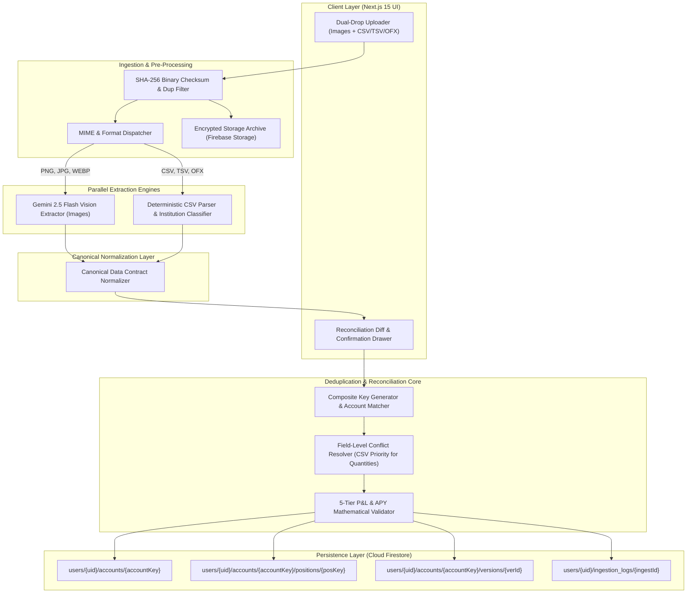

# BunBau (資本寶) - Dual-Source Data Ingestion Pipeline Architecture & PRD

**Document Version:** 2.0  
**Target Consumer:** Antigravity / Vibe Coding Agent (Gemini Flash / Claude Sonnet)  
**Scope:** Dual-Source Ingestion Pipeline (Brokerage Screenshot & CSV Reconciliation)  
**Parent Application:** BunBau Personal Wealth & Portfolio Intelligence Platform  
**Target Runtime:** Node.js 20 / Next.js 15 / Firebase Firestore & Storage / Google Cloud Run

---

## 1. Executive Summary & Problem Context

BunBau previously relied exclusively on Gemini Multimodal Vision to extract portfolio positions from user-submitted brokerage screenshots. While functional for top-level balances and visible positions, screenshot extraction presents critical operational limitations:
- **Occluded Data:** Extended account position tables spanning multiple viewport heights cannot be captured in single screenshots.
- **Missing Lot Details:** Crucial metadata—including exact tax-lot purchase dates, cost-basis breakdowns, precise bond/CD coupon APY, option contract Greeks, and settlement cash reserves—are frequently hidden behind expandable submenus or omitted from mobile displays.
- **Strategy Engine Gaps:** BunBau's Strategy & Rebalancing engine requires exact math and complete maturity dates to accurately model APY targets (e.g., 10% on $2M) and avoid unintended cash drag.

To solve this, this document specifies the **Dual-Source Data Ingestion Pipeline**. This mission-critical enhancement allows BunBau to ingest both **raw institution screenshots** and **exported institution CSV/OFX files** seamlessly.

### Core Pipeline Directives:
1. **Source Independence:** The pipeline must work seamlessly when only a screenshot is uploaded, when only a CSV is uploaded, or when both are uploaded together.
2. **Deterministic Deduplication & Reconciled Merging:** Matches positions and accounts across both sources using mathematical hashing. It never doubles cash, position counts, or asset valuations.
3. **Complementary Enrichment:** Leverages CSV numerical accuracy (cost basis, exact shares, strike price, maturity date) to corroborate and enrich visual screenshot data (unsettled funds, visual cash balances, instant UI state).
4. **Auditability, Lineage & Rollback:** Tracks cryptographic file hashes, upload timestamps, source provenance per line item, and provides point-in-time account version rollbacks.

---

## 2. High-Level Ingestion & Reconciliation Architecture



---

## 3. Ingestion Behavioral Rules & Scenarios

### 3.1 Supported Ingestion Scenarios

#### Scenario A: CSV Upload Only
- User exports and drops a CSV from Fidelity, Schwab, Webull, Citi, or another supported institution.
- The pipeline identifies the institution header pattern, runs the deterministic parser, normalizes rows into BunBau Canonical Positions, creates or matches the account, and tags position lineage as `dataSource: "CSV"`.

#### Scenario B: Screenshot Upload Only
- User uploads mobile or desktop screenshots.
- The pipeline invokes Gemini Flash Vision using structured schema prompts to extract institution name, masked account number, total portfolio value, cash balance, and visible position items.
- Positions are tagged with `dataSource: "SCREENSHOT"`.

#### Scenario C: Simultaneous or Asynchronous Dual Upload (Screenshot + CSV)
- The user uploads both formats in a single drag-and-drop batch, or uploads a CSV days after an initial screenshot.
- The system computes the composite account key:
  $$\text{accountKey} = \text{MD5}(\text{userId} + \text{institutionNormalized} + \text{accountMaskedNumber})$$
- If both sources map to the same `accountKey`, the **Field-Level Conflict Resolver** merges them according to strict precedence rules:
  1. **Quantity & Cost Basis:** CSV takes 100% precedence (eliminates OCR rounding or missing decimal errors).
  2. **Option Strikes & Expirations:** CSV takes precedence.
  3. **CD & Bond APY / Maturity:** CSV takes precedence. If the CSV lacks maturity but the screenshot displays it in a table row, the pipeline captures and merges the screenshot date.
  4. **Immediate Portfolio Net Worth & Cash Drag:** If the CSV represents a dated export while the screenshot reflects real-time midday balances, the screenshot balance is flagged for user confirmation in the Staging Drawer.
  5. The combined position lineage is marked `dataSource: "MERGED"`.

---

## 4. Deduplication & Idempotency Rules

1. **Binary Checksum Deduplication (File-Level):**
   - For every incoming file, compute an `SHA-256` hash.
   - If an identical `fileHash` exists in `users/{userId}/ingestion_logs` with status `MERGED`, reject the duplicate immediately with a toast: *"File already processed on [timestamp]"*.

2. **Account-Level Idempotency:**
   - Ingestion never appends duplicate accounts. An existing `accountKey` receives an incremental version number ($N+1$).
   - Previous active positions are marked `status: "SUPERSEDED"` or archived into `accounts/{accountKey}/versions/{versionId}`.

3. **Position-Level Composite Keying:**
   - Every individual position is keyed deterministically:
     $$\text{positionKey} = \text{MD5}(\text{accountKey} + \text{symbolNormalized} + \text{assetCategory} + (\text{maturityOrExpiryDate} \parallel \text{"NA"}))$$
   - This ensures identical holdings update their cost basis and market value in place instead of creating duplicate rows.

---

## 5. Canonical Data Contracts (TypeScript)

Both the CSV worker and Gemini Vision worker must transform their respective raw extractions into this exact canonical schema before persistence or UI rendering:

```typescript
export type AssetCategory = 
  | 'Cash' 
  | 'CD' 
  | 'Bond_SGOV' 
  | 'Stock' 
  | 'ETF' 
  | 'Option' 
  | 'Crypto';

export type DataSourceOrigin = 'SCREENSHOT' | 'CSV' | 'MERGED' | 'MANUAL';

export interface CanonicalOptionDetails {
  underlying: string;
  type: 'CALL' | 'PUT';
  strike: number;
  expirationDate: string; // ISO 8601: YYYY-MM-DD
  isCollateralizedCsp: boolean;
  contractsCount: number;
}

export interface CanonicalPosition {
  positionKey: string;
  accountKey: string;
  symbol: string;
  description: string;
  assetCategory: AssetCategory;
  quantity: number;
  costBasis: number;
  currentPrice: number;
  marketValue: number;
  unrealizedGainLoss: number;
  unrealizedGainLossPct: number;
  yieldApy?: number;
  maturityDate?: string; // ISO 8601: YYYY-MM-DD
  optionDetails?: CanonicalOptionDetails | null;
  dataSource: DataSourceOrigin;
  updatedAt: string;
}

export interface CanonicalAccountPayload {
  accountKey: string;
  institution: string;
  accountName: string;
  accountMaskedNumber: string;
  accountType: 'Brokerage' | 'Roth IRA' | 'Traditional IRA' | '401(k)' | 'Checking' | 'Savings' | 'Crypto';
  totalValue: number;
  cashBalance: number;
  positions: CanonicalPosition[];
  rawSourceFiles: {
    fileHash: string;
    fileName: string;
    fileType: 'IMAGE' | 'CSV';
    storagePath: string;
  }[];
  sourceType: 'SCREENSHOT' | 'CSV' | 'DUAL';
  extractedAt: string;
  version: number;
}
```

---

## 6. Cloud Firestore Database Schema

The database maintains user isolation and version rollback history:

```
firestore/
├── users/
│   └── {userId}/
│       ├── profile/
│       │   └── settings (doc)
│       ├── accounts/
│       │   └── {accountKey}/                 <-- MD5(userId + inst + mask)
│       │       ├── metadata (doc)           <-- Active totals, version count, status
│       │       ├── positions/
│       │       │   └── {positionKey} (doc)  <-- Only active current positions
│       │       └── versions/
│       │           └── {versionId} (doc)    <-- Immutable snapshots of past imports
│       ├── ingestion_logs/
│       │   └── {ingestionId}/               <-- Audit log per file uploaded
│       │       ├── fileHash: string
│       │       ├── fileName: string
│       │       ├── fileType: 'CSV' | 'SCREENSHOT'
│       │       ├── status: 'PENDING' | 'MERGED' | 'REJECTED'
│       │       ├── storagePath: string
│       │       ├── matchedAccountKeys: string[]
│       │       └── createdAt: timestamp
│       └── snapshots/                       <-- Portfolio-wide historical states
│           └── {snapshotId} (doc)
```

---

## 7. CSV Parser Adapter Registry Specifications

The CSV parser layer contains modular adapters with automatic header signature detection:

### 7.1 Charles Schwab Adapter (`SchwabCSVAdapter`)
- **Header Triggers:** Contains `"Positions for account"`, `"Symbol"`, `"Description"`, `"Quantity"`, `"Price"`, `"Amount"`, `"Cost Basis"`.
- **Cash Handling:** Schwab lists `"Cash & Cash Investments"` as a line item with dollar amounts. Maps to `assetCategory: "Cash"`.
- **CD Detection:** Descriptions containing `"CD"`, `"CERTIFICATE OF DEPOSIT"`, or maturity timestamps map to `assetCategory: "CD"`. Extracts maturity dates via regex `\d{2}/\d{2}/\d{4}`.

### 7.2 Fidelity Adapter (`FidelityCSVAdapter`)
- **Header Triggers:** Contains `"Account Name/Number"`, `"Symbol"`, `"Description"`, `"Quantity"`, `"Last Price"`, `"Current Value"`.
- **Cash Handling:** Recognizes `"Pending Activity"`, `"SPAXX**"`, or `"HELD IN CASH"` as `assetCategory: "Cash"`.
- **Options Handling:** Symbol formats such as `-AAPL261016C150` parse into Call contracts with strike \$150 and expiration 2026-10-16.

### 7.3 Generic Fallback Adapter (`GenericCSVAdapter`)
- For non-standard institutions (Bank of China, HSBC, Webull export variations), uses an LLM schema-mapping worker (Gemini 2.5 Flash) to infer column mappings, then validates that `Quantity * Price ≈ Market Value`.

---

## 8. API Endpoints Specification

### 1. `POST /api/v1/ingest/upload`
- **Request:** `multipart/form-data` containing `files: File[]`.
- **Handler Actions:**
  1. Computes SHA-256 for all incoming files.
  2. Archives raw files to Firebase Storage (`users/{userId}/raw_ingest/{timestamp}_{fileName}`).
  3. Dispatches image files to Gemini Vision parsing worker.
  4. Dispatches tabular files to CSV Parser Registry.
  5. Assembles normalized accounts and detects matching existing `accountKey`s.
- **Response:** Staged extraction preview payload for user review.

### 2. `POST /api/v1/ingest/confirm`
- **Request:** `{ stagingId: string, confirmedAccounts: CanonicalAccountPayload[] }`
- **Handler Actions:**
  1. Opens Firestore batch write.
  2. Copies existing positions of targeted accounts to `versions/{versionId}`.
  3. Replaces active documents in `positions/` subcollection.
  4. Updates account `metadata` document with new totals and incremented version.
  5. Triggers portfolio-wide 5-tier P&L and blended APY recalculations.
- **Response:** `{ success: true, updatedAccountKeys: string[] }`.

### 3. `GET /api/v1/ingest/history`
- **Response:** Chronological list of all uploaded files, detected institutions, matched accounts, and success states.

### 4. `POST /api/v1/ingest/rollback`
- **Request:** `{ accountKey: string, targetVersion: number }`
- **Handler Actions:** Restores positions from the specified version document, rewrites the active subcollection, and updates metadata.

---

## 9. Antigravity Verification & Automated Test Suite

Before declaring the data ingestion enhancement ready for production, Antigravity must execute and pass these test specifications:

- [ ] **Test Case 1 (Standalone CSV Parse):** Upload a test Schwab CSV. Verify positions, quantities, and cash balance parse accurately with zero NaN fields.
- [ ] **Test Case 2 (Standalone Screenshot Parse):** Upload a test Fidelity screenshot. Verify Gemini Flash extracts account identifier and positions matching the canonical interface.
- [ ] **Test Case 3 (Dual Simultaneous Upload - Conflict Resolution):** Upload both a Schwab CSV and Schwab screenshot for the same account. Verify that share counts and cost bases match the CSV numbers, cash drag matches the screenshot, and no positions are duplicated.
- [ ] **Test Case 4 (Idempotent Incremental Update):** Upload an initial CSV, then upload an updated CSV where one stock position has changed quantity. Verify version increments to $N+1$, old positions archive to `versions/`, and total net worth reflects the new total without double-counting.
- [ ] **Test Case 5 (Corrupt / Unrecognized Upload):** Upload a malformed text file or corrupted image. Verify system returns friendly client validation errors without writing corrupt documents to Firestore.